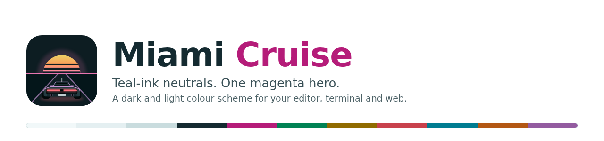
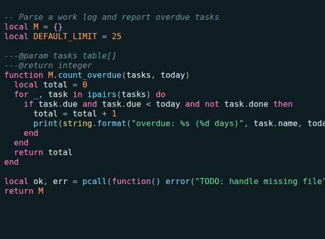
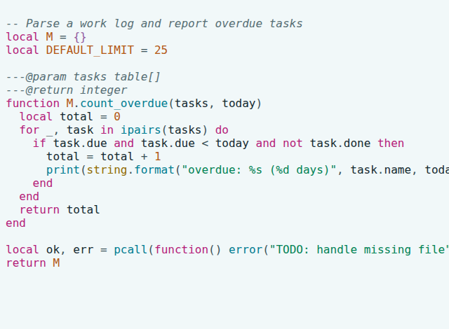
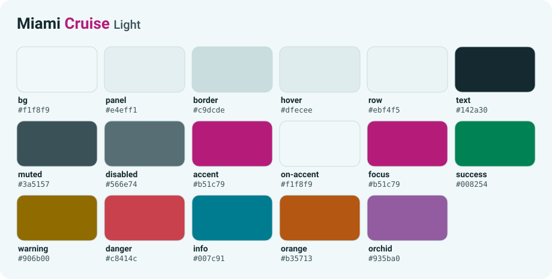

<h3 align="center">
  <picture>
    <source media="(prefers-color-scheme: dark)" srcset="brand/banner-dark.png">
    
  </picture>
</h3>

<p align="center">
  
  
  
</p>

<p align="center">
  <a href="https://lanjelin.github.io/miami-cruise"><b>Website</b></a> &nbsp;·&nbsp;
  <a href="#supported-apps">Install</a> &nbsp;·&nbsp;
  <a href="docs/PORTING.md">Port to your app</a> &nbsp;·&nbsp;
  <a href="CONTRIBUTING.md">Contribute</a>
</p>

<p align="center">
  A dark and light colour scheme for your editor, terminal and web, with <b>teal-ink neutrals</b> and a <b>single magenta hero accent</b>.<br>
  Inspired by 80s night drives, tuned for long days in front of a screen.
</p>

<table>
  <tr>
    <td></td>
    <td></td>
  </tr>
</table>

## Why Miami Cruise

- **One hero.** Magenta is the only loud colour. It marks keywords, selection, focus and links. Everything else stays calm, so what matters stands out.
- **Dark and light, same identity.** Both variants share one tinted hue family and ship together.
- **Readable by construction.** The palette is defined in [OKLCH](https://oklch.com), and the build adjusts every text and accent colour until it reaches at least 4.5:1 contrast against the background. It fails if it can't.
- **Meaning without glow.** Selection is a tint plus a solid stripe, and focus is a solid outline. The optional glow layer only decorates them, so ports without shadows lose nothing.
- **One source.** Every port is generated from the same palette, so they never drift apart.

## Palette

<picture>
  <source media="(prefers-color-scheme: dark)" srcset="dist/brand/palette-dark.svg">
  
</picture>

The light and dark palettes, with the full specification and contrast ratios, are in [docs/SPEC.md](docs/SPEC.md).

## Supported apps

Every theme is a ready-to-use file in [`dist/`](dist); nothing needs building. Each app has its own folder with a README that explains how to install it, and the [website](https://lanjelin.github.io/miami-cruise) has the same guides with downloads for macOS, Linux and Windows.

<!-- apps:start -->
| App | Install guide | Status |
|---|---|---|
| Neovim | [`dist/nvim`](dist/nvim) | Stable. Tested on Neovim 0.12 with Treesitter |
| Vim | [`dist/vim`](dist/vim) | Stable. Tested on Vim 9.1 |
| WezTerm | [`dist/wezterm`](dist/wezterm) | Beta. Logic and colour fields checked; not yet run in the app on every platform |
| Web / CSS | [`dist/web`](dist/web) | Stable. The project's own website is built on it |
| Design tokens | [`dist/tokens`](dist/tokens) | Design tokens as JSON |
<!-- apps:end -->

Your app isn't listed? [Request a port](../../issues/new/choose) or [write one](docs/PORTING.md); a port is a single small file.

## Repository

```
dist/          the themes and their install guides, generated from the palette and committed
themes/        one module per app: the theme and its install guide
palette.py     the palette: OKLCH values and contrast rules
website/       the source of the project website, built separately
brand/         logo, banner and social-preview sources
docs/          specification, porting guide, distribution plan
previews/      screenshots and the samples they come from
```

To rebuild after changing the palette or a port: `python3 -I build.py` (Python 3, no dependencies). `dist/`, `docs/SPEC.md` and the apps table above are generated, so CI fails if they are out of date.

## Contributing

Contributions are welcome: bug reports, ports to new apps, and fixes. Read [CONTRIBUTING.md](CONTRIBUTING.md) and the [porting guide](docs/PORTING.md), and please follow the [code of conduct](CODE_OF_CONDUCT.md). Changes to the palette affect every port, so open an issue to discuss them first.

## Licence

[MIT](LICENSE). Free to use, change and share.
