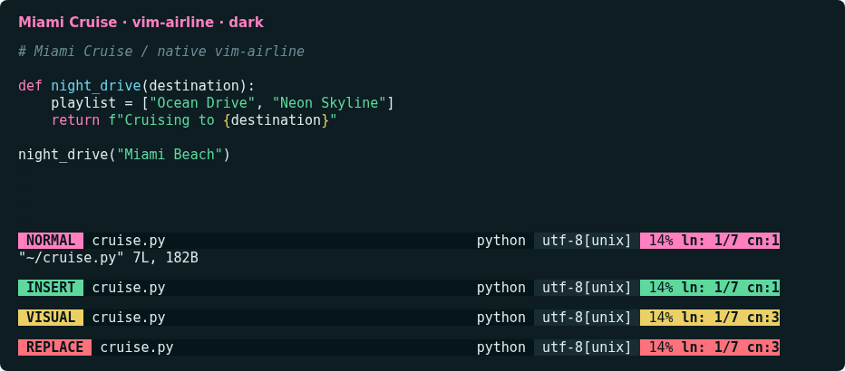
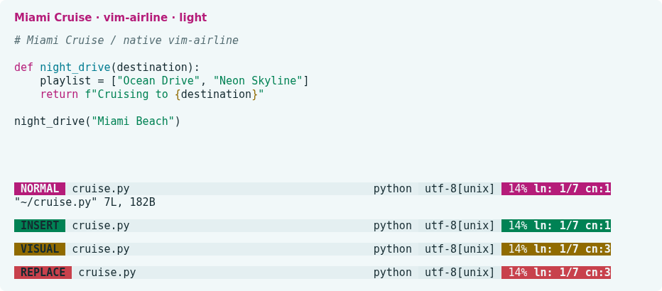

# Miami Cruise for vim-airline

Mode-aware Miami Cruise colours for your existing airline status line.




## Install

The theme files:

- [`autoload/airline/themes/miami_cruise.vim`](autoload/airline/themes/miami_cruise.vim): Native airline theme · dark and light

Requires vim-airline, not bundled. Independent of the Vim/Neovim Miami Cruise colorscheme; preserves sections, separators and extensions. Includes xterm-256 fallbacks.

Run the commands below from the [`autoload/airline/themes/`](autoload/airline/themes) folder, or from wherever you saved the file.

### 1. Install into your runtime path

Install vim-airline first using your existing plugin manager. Download miami_cruise.vim, then copy it into the matching runtime directory. Back up any existing same-named file.

**Vim · Linux / macOS**

```sh
mkdir -p ~/.vim/autoload/airline/themes
cp miami_cruise.vim ~/.vim/autoload/airline/themes/
```

**Neovim · Linux / macOS**

```sh
mkdir -p ~/.config/nvim/autoload/airline/themes
cp miami_cruise.vim ~/.config/nvim/autoload/airline/themes/
```

On Windows use vimfiles/autoload/airline/themes under your Vim user directory, or autoload/airline/themes under Neovim’s stdpath("config"). Respect custom XDG/runtime paths.

### 2. Select the theme

Merge into your existing vimrc/init.vim, before airline initializes. Select light instead for a light terminal. For init.lua use vim.g.airline_theme = "miami_cruise" and vim.o.background = "dark".

```vim
set background=dark
set termguicolors
let g:airline_theme = "miami_cruise"
```

Restart the editor, or run :AirlineTheme miami_cruise. After changing background, run that command again to reload the matching palette. No fonts, layout, editor colorscheme or automatic system appearance switching are configured.

### 3. Restore

Restore your previous airline_theme setting and any replaced file, then restart the editor or select the previous theme with :AirlineTheme. Remove only this installation’s unchanged file. Do not remove vim-airline or unrelated settings.

> [!NOTE]
> Native theme reference: https://github.com/vim-airline/vim-airline/blob/master/autoload/airline/themes/dark.vim

## Details

- **Variants:** dark and light
- **Covers:** Normal, insert, visual, replace, terminal and inactive modes; modified buffers and warning/error accents
- **Glow:** No: the flat palette
- **Tested:** Native Vim loading, palette switching and mode-map checks passed; user visual verification reported on 2026-11-13. Plugin version, OS and exact visual-test coverage not recorded

## More

- [Website page for vim-airline](https://lanjelin.github.io/miami-cruise/apps/airline.html)
- [Palette and specification](../../docs/SPEC.md)
- [Report a problem](https://github.com/lanjelin/miami-cruise/issues/new/choose)
- [MIT licence](../../LICENSE)
