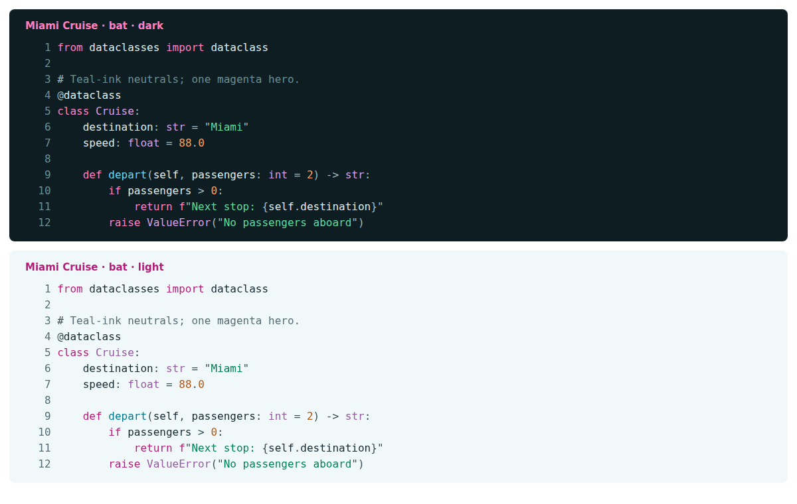

# Miami Cruise for bat

Readable syntax highlighting for source files, with Miami Cruise colours.



## Install

The theme files:

- [`miami-cruise-dark.tmTheme`](miami-cruise-dark.tmTheme): Dark theme
- [`miami-cruise-light.tmTheme`](miami-cruise-light.tmTheme): Light theme

Run the commands below from this folder, or from wherever you saved the file.

### 1. Install the syntax themes

Install bat first (some Linux packages name the command `batcat`). Use a true-colour terminal with the matching dark or light background. These commands use bat's own config directory and do not replace your config file.

**macOS / Linux**

```bash
bat_dir="$(bat --config-dir)"
mkdir -p "$bat_dir/themes"
cp miami-cruise-dark.tmTheme miami-cruise-light.tmTheme "$bat_dir/themes/"
bat cache --build
bat --list-themes
```

**Windows (PowerShell)**

```powershell
$batDir = bat --config-dir
New-Item -ItemType Directory -Force "$batDir/themes" | Out-Null
Copy-Item miami-cruise-dark.tmTheme, miami-cruise-light.tmTheme "$batDir/themes/"
bat cache --build
bat --list-themes
```

> [!NOTE]
> If files with these same names already exist, back them up before copying. To uninstall, remove just these two files from the themes directory and run `bat cache --build` again. Existing unrelated themes are preserved.

### 2. Choose a variant

```bash
bat --theme=miami-cruise-dark --color=always --paging=never build.py
```

Use `--theme=miami-cruise-light` for light mode. To make your choice persistent, add `--theme=miami-cruise-dark` to the config file reported by `bat --config-file`, preserving your other options. A command-line `--theme` overrides the default.

> [!NOTE]
> bat colours the output, not the terminal's background. Use the matching Miami Cruise terminal palette. This port does not automatically switch variants.

## Details

- **Variants:** dark and light
- **Covers:** Keywords, strings, numbers, functions, types, comments, markup, punctuation and gutters
- **Glow:** No: terminal output uses the flat palette
- **Tested:** bat 0.26.1 on Linux: both variants, custom cache loading, Python, JavaScript, Rust, JSON and Markdown; macOS and Windows not tested

## More

- [Website page for bat](https://lanjelin.github.io/miami-cruise/apps/bat.html)
- [Palette and specification](../../docs/SPEC.md)
- [Report a problem](https://github.com/lanjelin/miami-cruise/issues/new/choose)
- [MIT licence](../../LICENSE)
