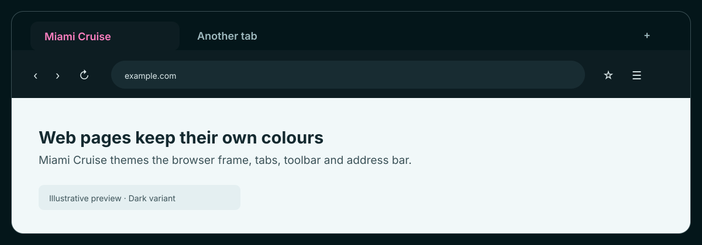
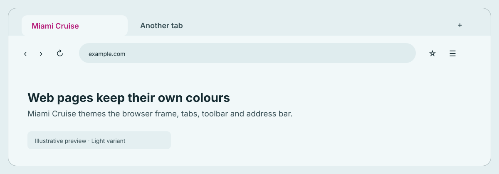

# Miami Cruise for Brave

Miami Cruise colours for Brave tabs, toolbar and address bar.

## Install

Choose one variant:

- [`miami-cruise-brave-dark.zip`](miami-cruise-brave-dark.zip): Brave/Chromium theme · dark
- [`miami-cruise-brave-light.zip`](miami-cruise-brave-light.zip): Brave/Chromium theme · light

Each ZIP contains a native Chromium theme manifest and the MIT licence. There are no scripts, extension permissions or web-page modifications. Keep the extracted folder after installing it.

### 1. Extract your chosen ZIP

Extract the dark or light ZIP to a permanent folder. Open the extracted folder and check that `manifest.json` is directly inside it. Do not select the ZIP itself or the parent folder.

### 2. Load the theme in Brave

Open `brave://extensions`, enable **Developer mode**, choose **Load unpacked**, and select the folder containing `manifest.json`. The browser chrome should update immediately. This local-install flow is for desktop Brave.

> [!NOTE]
> Brave may show a developer-mode warning for locally loaded themes. The ZIP contains only a colour manifest and a licence file; it does not request permissions or run code.

### 3. Switch or remove

To change between dark and light, load the other extracted folder through `brave://extensions`. Only one browser theme can be active at a time; switching is manual. To remove Miami Cruise, open `brave://extensions` and remove its theme, or reset the theme in `brave://settings/appearance`.

> [!NOTE]
> This colours Brave's browser chrome, not websites. Brave's New Tab background and some built-in UI surfaces have their own controls and may not follow these theme colours. The theme does not automatically follow your OS dark/light setting.

## Details

- **Variants:** Separate dark and light theme packages; manual switching
- **Covers:** Browser frame, active/inactive tabs, toolbar icons and text, bookmarks and address bar
- **Glow:** No: a flat palette
- **Tested:** Brave Browser 156.1.98.60 on Linux: both ZIPs extracted and each recorded as the active theme in a separate isolated headless profile. Visible browser chrome, persistence and macOS/Windows installation not verified

## More

- [Website page for Brave](https://lanjelin.github.io/miami-cruise/apps/brave.html)
- [Palette and specification](../../docs/SPEC.md)
- [Report a problem](https://github.com/lanjelin/miami-cruise/issues/new/choose)
- [MIT licence](../../LICENSE)
