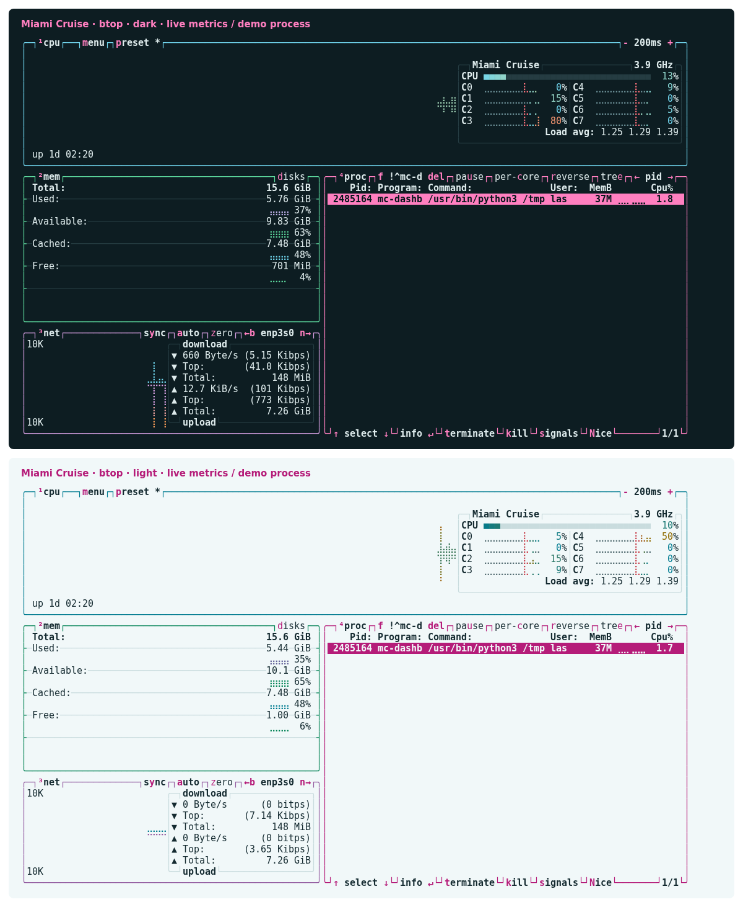

# Miami Cruise for btop

A calm system dashboard with readable graphs and magenta focus.



## Install

The theme files:

- [`miami-cruise-dark.theme`](miami-cruise-dark.theme): Native btop theme · dark
- [`miami-cruise-light.theme`](miami-cruise-light.theme): Native btop theme · light

These are native `.theme` files, not `btop.conf` replacements. They only define colours; your monitoring settings and layout stay unchanged.

Run the commands below from this folder, or from wherever you saved the file.

### 1. Install the native theme files

Install btop first. Copy the two theme files into your btop themes directory. This does not replace your existing `btop.conf`. If you previously customized files with the same names, keep a backup before replacing those files.

**Linux / macOS**

```bash
btop_dir="${XDG_CONFIG_HOME:-$HOME/.config}/btop"
mkdir -p "$btop_dir/themes"
cp miami-cruise-dark.theme miami-cruise-light.theme "$btop_dir/themes/"
btop
```

Inside btop, press `Esc` to open the menu, choose `Options`, then select `miami-cruise-dark` or `miami-cruise-light` under `Color theme`. btop saves the selection on exit. There is no automatic dark/light switching in these theme files.

### 2. Use your terminal background without replacing your config

Enable `Truecolor` and disable `Theme background` in Options to let your terminal background show through. If editing your existing `btop.conf` while btop is closed, update these existing keys rather than appending duplicate settings:

```ini
color_theme = "miami-cruise-dark"
truecolor = true
theme_background = false
```

> [!NOTE]
> With `theme_background = false`, btop uses your terminal background; use a matching terminal theme. Set it to `true` if you prefer the exact Miami Cruise background. `--low-color` quantizes RGB to 256 colours. TTY mode forces btop's built-in 16-colour TTY theme, so it cannot show the full palette. Process colour/gradient settings also affect how the colour ramps appear.

If you use a nonstandard theme folder or launch btop with a custom `--config` file, pass an explicit theme directory. These options are supported by the tested btop 1.4.8:

**Linux / macOS**

```bash
btop --themes-dir /absolute/path/to/themes
# With your own config file:
btop --config /absolute/path/to/btop.conf --themes-dir /absolute/path/to/themes
```

To uninstall, select another theme in Options and exit btop, then remove the two Miami Cruise theme files. Other btop settings are left intact.

> [!NOTE]
> This port targets btop on Linux/macOS. Windows btop4win and bpytop/bashtop have not been tested. GPU-specific monitoring is hardware-dependent and was not available during testing. Native theme reference: https://github.com/aristocratos/btop#themes

## Details

- **Variants:** dark and light
- **Covers:** Surfaces, titles, shortcuts, selection, process-state banners, panel borders, meters and CPU/temperature/memory/disk/network/process colour ramps
- **Glow:** No: the flat palette
- **Tested:** btop 1.4.8 on Linux: both themes, CPU/memory/network/process panels, selection, pause/follow banners, filter, help/options, theme switching and custom config/theme paths; true-colour and 256-colour modes; macOS and GPU hardware not tested

## More

- [Website page for btop](https://lanjelin.github.io/miami-cruise/apps/btop.html)
- [Palette and specification](../../docs/SPEC.md)
- [Report a problem](https://github.com/lanjelin/miami-cruise/issues/new/choose)
- [MIT licence](../../LICENSE)
