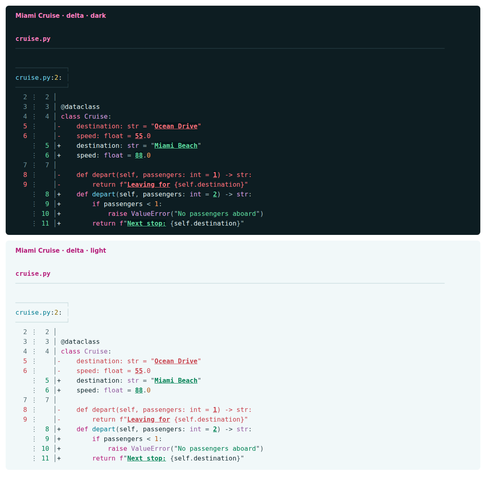

# Miami Cruise for delta

A Miami Cruise diff: clear additions, removals and inline changes.



## Install

The theme files:

- [`miami-cruise.gitconfig`](miami-cruise.gitconfig): Delta themes (both variants)
- [`miami-cruise-dark.tmTheme`](miami-cruise-dark.tmTheme): Dark syntax theme
- [`miami-cruise-light.tmTheme`](miami-cruise-light.tmTheme): Light syntax theme

Run the commands below from this folder, or from wherever you saved the file.

### 1. Install the syntax themes

Install bat first (some Linux packages name the command `batcat`). Use a true-colour terminal with the matching dark or light background. These commands use bat's own config directory and do not replace your config file.

**macOS / Linux**

```bash
bat_dir="$(bat --config-dir)"
mkdir -p "$bat_dir/themes"
cp miami-cruise-dark.tmTheme miami-cruise-light.tmTheme "$bat_dir/themes/"
bat cache --build
bat --list-themes
```

**Windows (PowerShell)**

```powershell
$batDir = bat --config-dir
New-Item -ItemType Directory -Force "$batDir/themes" | Out-Null
Copy-Item miami-cruise-dark.tmTheme, miami-cruise-light.tmTheme "$batDir/themes/"
bat cache --build
bat --list-themes
```

> [!NOTE]
> If files with these same names already exist, back them up before copying. To uninstall, remove just these two files from the themes directory and run `bat cache --build` again. Existing unrelated themes are preserved.

### 2. Include the delta theme file

Install delta. Save `miami-cruise.gitconfig` somewhere permanent. Add the following to your Git config (usually `~/.gitconfig`), using the actual absolute path. On Windows, forward slashes work in the path, for example `C:/Users/you/.config/delta/miami-cruise.gitconfig`.

```gitconfig
[include]
    path = /absolute/path/to/miami-cruise.gitconfig

[delta]
    features = miami-cruise-dark
```

> [!NOTE]
> Merge these sections with your existing config. Keep other feature names you want, but select only one Miami Cruise variant. Explicit colour settings in your main delta config can override the feature. The theme does not force side-by-side view, paging or line-number preferences.

Choose `miami-cruise-light` instead for light mode. Custom syntax requires bat's cache setup above; delta and bat should use compatible versions and the same cache directory. Verify discovery with `delta --list-syntax-themes`. The two syntax files are identical to the bat port; no separate copy is needed if already installed.

> [!NOTE]
> bat is needed to build the custom syntax cache, not to run delta afterwards. delta reads that cache directly.

> [!WARNING]
> delta 0.20.1 does not honour `BAT_CACHE_PATH`. If you use that override, rebuild bat's cache in the default location for delta, or set the same absolute `XDG_CACHE_HOME` for both tools on macOS/Linux (cache: `$XDG_CACHE_HOME/bat`). Use compatible bat versions; these themes were verified with bat 0.26.1.

### 3. Try it, then optionally make it your Git pager

```bash
git diff --no-ext-diff --no-color | delta --features=miami-cruise-dark --paging=never
```

If you want delta as your pager, merge the following settings into Git config. Skip this if your pager is already configured.

```gitconfig
[core]
    pager = delta

[interactive]
    diffFilter = delta --color-only
```

To uninstall, remove the include and Miami Cruise feature name, and undo the pager settings only if you added them. Use the matching terminal background and a true-colour terminal; variant switching is manual.

## Details

- **Variants:** dark and light
- **Covers:** Syntax, diff lines, inline emphasis, file/hunk/commit headers and line numbers
- **Glow:** No: terminal output uses the flat palette
- **Tested:** delta 0.20.1 with bat 0.26.1 on Linux: both features, syntax cache, unified and side-by-side diffs, additions, removals and inline changes; macOS and Windows not tested

## More

- [Website page for delta](https://lanjelin.github.io/miami-cruise/apps/delta.html)
- [Palette and specification](../../docs/SPEC.md)
- [Report a problem](https://github.com/lanjelin/miami-cruise/issues/new/choose)
- [MIT licence](../../LICENSE)
