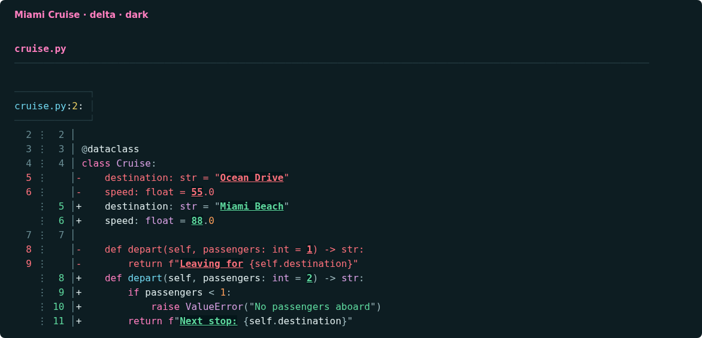
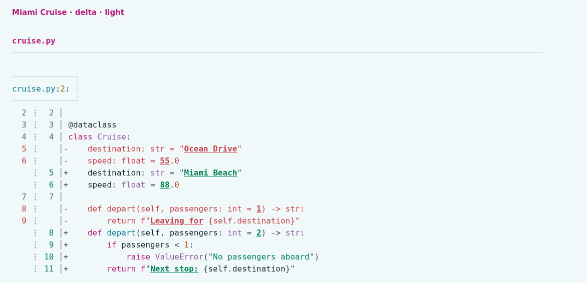

# Miami Cruise for delta

A Miami Cruise diff on your terminal background, with clear inline changes.




## Install

Delta configuration and supporting syntax files:

- [`miami-cruise.gitconfig`](miami-cruise.gitconfig): Native delta theme (both variants)
- [`miami-cruise-dark.tmTheme`](miami-cruise-dark.tmTheme): Supporting dark syntax palette (TextMate)
- [`miami-cruise-light.tmTheme`](miami-cruise-light.tmTheme): Supporting light syntax palette (TextMate)

`miami-cruise.gitconfig` is the native delta theme: it defines the dark/light features and diff styles. The `.tmTheme` files supply custom code-syntax colours to delta's bat-based highlighter; they are not replacements for the Git-config file. All three files are intentional parts of this delta port.

Run the commands below from this folder, or from wherever you saved the file.

### 1. Configure delta's native theme

Install delta. Save `miami-cruise.gitconfig` somewhere permanent. Add the following to your Git config (usually `~/.gitconfig`), using the actual absolute path. On Windows, forward slashes work in the path, for example `C:/Users/you/.config/delta/miami-cruise.gitconfig`.

```gitconfig
[include]
    path = /absolute/path/to/miami-cruise.gitconfig

[delta]
    features = miami-cruise-dark
```

> [!NOTE]
> Merge these sections with your existing config. Keep other feature names you want, but select only one Miami Cruise variant. Explicit colour settings in your main delta config can override the feature. The theme does not force side-by-side view, paging or line-number preferences.

Choose `miami-cruise-light` instead for light mode. The next step installs the supporting code-syntax palettes. Ordinary diff lines and hunk headers inherit the terminal background; inline changes and whitespace errors retain intentional fills. Use a true-colour terminal with a matching dark/light background.

> [!NOTE]
> bat is needed to build the custom syntax cache, not to run delta afterwards. delta reads that cache directly.

> [!WARNING]
> delta 0.20.1 does not honour `BAT_CACHE_PATH`. If you use that override, rebuild bat's cache in the default location for delta, or set the same absolute `XDG_CACHE_HOME` for both tools on macOS/Linux (cache: `$XDG_CACHE_HOME/bat`). Use compatible bat versions; these themes were verified with bat 0.26.1.

### 2. Install delta's supporting syntax palettes

delta uses bat's syntax-highlighting engine and reads its custom syntax cache. The two `.tmTheme` files are supporting syntax palettes, not delta feature configurations. Install bat to build that cache (some Linux packages call it `batcat`); delta does not run bat afterwards. If you already installed the Miami Cruise bat themes, skip copying them and check discovery below. See <a href="https://dandavison.github.io/delta/supported-languages-and-themes.html">delta's custom-syntax documentation</a>.

**macOS / Linux**

```bash
bat_dir="$(bat --config-dir)"
mkdir -p "$bat_dir/themes"
cp miami-cruise-dark.tmTheme miami-cruise-light.tmTheme "$bat_dir/themes/"
bat cache --build
bat --list-themes
```

**Windows (PowerShell)**

```powershell
$batDir = bat --config-dir
New-Item -ItemType Directory -Force "$batDir/themes" | Out-Null
Copy-Item miami-cruise-dark.tmTheme, miami-cruise-light.tmTheme "$batDir/themes/"
bat cache --build
bat --list-themes
```

> [!NOTE]
> If files with these same names already exist, back them up before copying. To uninstall, remove just these two files from the themes directory and run `bat cache --build` again. Existing unrelated themes are preserved.

Confirm that delta discovers both palettes. You should see `miami-cruise-dark` and `miami-cruise-light`:

```bash
delta --no-gitconfig --list-syntax-themes
```

### 3. Try it, then optionally make it your Git pager

```bash
git diff --no-ext-diff --no-color | delta --features=miami-cruise-dark --paging=never
```

If you want delta as your pager, merge the following settings into Git config. Skip this if your pager is already configured.

```gitconfig
[core]
    pager = delta

[interactive]
    diffFilter = delta --color-only
```

To uninstall, remove the include and Miami Cruise feature name, and undo the pager settings only if you added them. Use the matching terminal background and a true-colour terminal; variant switching is manual.

## Details

- **Variants:** dark and light
- **Covers:** Syntax, diff lines, inline emphasis, file/hunk/commit headers and line numbers
- **Glow:** No: terminal output uses the flat palette
- **Tested:** delta 0.20.1 with bat 0.26.1 on Linux: both features, syntax cache, unified and side-by-side diffs, additions, removals and inline changes; macOS and Windows not tested

## More

- [Website page for delta](https://lanjelin.github.io/miami-cruise/apps/delta.html)
- [Palette and specification](../../docs/SPEC.md)
- [Report a problem](https://github.com/lanjelin/miami-cruise/issues/new/choose)
- [MIT licence](../../LICENSE)
