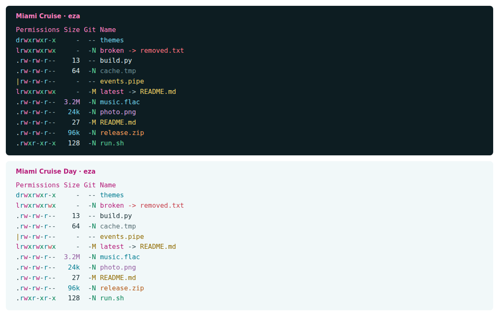

# Miami Cruise for eza

A true-colour file listing, from directories and permissions to Git status.



## Install

The theme files:

- [`miami-cruise-dark.yml`](miami-cruise-dark.yml): Dark theme
- [`miami-cruise-light.yml`](miami-cruise-light.yml): Light theme

Run the commands below from this folder, or from wherever you saved the file.

### 1. Install a variant as theme.yml

Install eza first. Use a true-colour terminal with the matching Miami Cruise dark or light background; eza only colours the listing, not the terminal itself.

> [!NOTE]
> The commands below save an existing `theme.yml` as `theme.yml.bak` once. If you have custom filename or icon rules, merge those into the new file afterwards.

**macOS / Linux**

```bash
eza_dir="${EZA_CONFIG_DIR:-${XDG_CONFIG_HOME:-$HOME/.config}/eza}"
mkdir -p "$eza_dir"
if [ -f "$eza_dir/theme.yml" ] && [ ! -e "$eza_dir/theme.yml.bak" ]; then
  cp "$eza_dir/theme.yml" "$eza_dir/theme.yml.bak"
fi
cp miami-cruise-dark.yml "$eza_dir/theme.yml"
export EZA_CONFIG_DIR="$eza_dir"
```

**Windows (PowerShell)**

```powershell
$ezaDir = if ($env:EZA_CONFIG_DIR) { $env:EZA_CONFIG_DIR } else { Join-Path $env:APPDATA "eza" }
New-Item -ItemType Directory -Force $ezaDir | Out-Null
$theme = Join-Path $ezaDir "theme.yml"
if ((Test-Path $theme) -and !(Test-Path "$theme.bak")) { Copy-Item $theme "$theme.bak" }
Copy-Item miami-cruise-dark.yml $theme
$env:EZA_CONFIG_DIR = $ezaDir
```

For light mode, use `miami-cruise-light.yml` instead. eza reads `theme.yml` on each invocation; it has no automatic dark/light switch.

> [!NOTE]
> On macOS the native default config location may differ from Linux. The explicit `EZA_CONFIG_DIR` above makes the location unambiguous. Keep that variable in your shell profile if using this location on macOS or a custom location on any platform.

### 2. Try it without colour overrides

**macOS / Linux**

```bash
env -u LS_COLORS -u EZA_COLORS -u EXA_COLORS eza --long --git --color=always
```

**Windows (PowerShell)**

```powershell
eza --long --git --color=always
```

> [!WARNING]
> `LS_COLORS` and `EZA_COLORS` override theme colours. Legacy `EXA_COLORS` is used when `EZA_COLORS` is unset. Remove conflicting settings from your shell configuration if you want the full palette. Icons are optional and need a Nerd Font; their glyphs are left at eza's defaults.

> [!NOTE]
> Theme format and configuration reference: https://github.com/eza-community/eza/blob/main/man/eza_colors-explanation.5.md

## Details

- **Variants:** dark and light
- **Covers:** File kinds and categories, permissions, owners, sizes, dates, links, Git status, repository status and metadata
- **Glow:** No: a flat palette
- **Tested:** eza 0.23.5 on Linux, both variants: true-colour output, file types, permissions, sizes, Git status and symlinks; macOS and Windows not tested

## More

- [Website page for eza](https://lanjelin.github.io/miami-cruise/apps/eza.html)
- [Palette and specification](../../docs/SPEC.md)
- [Report a problem](https://github.com/lanjelin/miami-cruise/issues/new/choose)
- [MIT licence](../../LICENSE)
