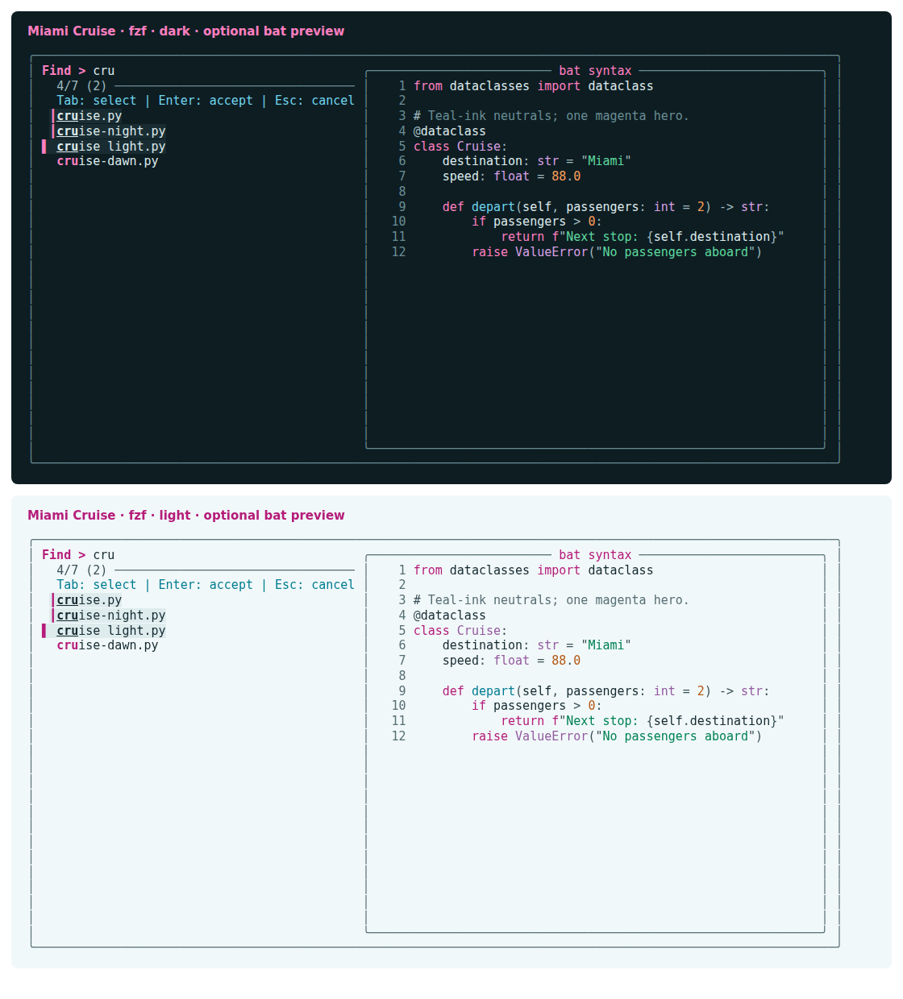

# Miami Cruise for fzf

Magenta search highlights, clear selections and a calm true-colour picker.



## Install

The theme files:

- [`miami-cruise-dark.opts`](miami-cruise-dark.opts): Native fzf options · dark
- [`miami-cruise-light.opts`](miami-cruise-light.opts): Native fzf options · light

These are plain fzf option files containing only `--color`, not shell scripts. Do not source them. No dependency on bat or delta is required.

Run the commands below from this folder, or from wherever you saved the file.

### 1. Load the colours alongside your current options

Install fzf first and keep the downloaded file in a permanent folder. Append its contents to your current `FZF_DEFAULT_OPTS`, using the actual absolute path. Existing bindings, layout and preview commands remain unchanged. Run once in your current shell to try it.

**Bash / Zsh**

```bash
export FZF_DEFAULT_OPTS="${FZF_DEFAULT_OPTS-} $(cat /absolute/path/to/miami-cruise-dark.opts)"
fzf
```

**Fish**

```fish
set -gx FZF_DEFAULT_OPTS "$FZF_DEFAULT_OPTS "(string join " " < /absolute/path/to/miami-cruise-dark.opts)
fzf
```

**Windows (PowerShell)**

```powershell
$theme = [System.IO.File]::ReadAllText("C:/absolute/path/to/miami-cruise-dark.opts").Trim()
$env:FZF_DEFAULT_OPTS = "$env:FZF_DEFAULT_OPTS $theme"
fzf
```

For light mode, substitute `miami-cruise-light.opts`. There is no automatic switching in these files. To keep the theme, add the corresponding assignment once after your existing fzf options in your shell config; do not replace your config or repeatedly append the assignment. Remove that assignment to uninstall, then start a new shell.

> [!NOTE]
> fzf also supports `FZF_DEFAULT_OPTS_FILE`. If you do not already use it, you may point it at this file instead. If you already have an options file, keep it and use the append method above: replacing the variable would discard that file's settings. Explicit command-line colour options and integration-specific overrides can take precedence.

### 2. Optional: add a matching bat preview

The fzf theme colours the picker and preview frame, not syntax emitted by other programs. Install the separate Miami Cruise bat port only if you want matching syntax colours. Then try this from a directory of source files (requires `rg` and `bat`):

**Bash / Zsh**

```bash
rg --files | fzf --multi --preview 'bat --color=always --paging=never --style=numbers --theme=miami-cruise-dark -- {}' --preview-window=right:60%
```

For light mode, change both the loaded fzf options and bat's theme name. The preview command is an example only; the downloaded theme does not set a preview, keybindings, commands or layout.

> [!NOTE]
> Use a true-colour terminal. ANSI-coloured input and preview output may supply their own colours. The tested release is fzf 0.75.0; older versions may not recognize newer colour names. Native option reference: https://github.com/junegunn/fzf/blob/master/man/man1/fzf.1

## Details

- **Variants:** dark and light
- **Covers:** Text, surfaces, search matches, current and multi-selected rows, markers, prompt, counters, borders, labels, scrollbars, header, footer and preview chrome
- **Glow:** No: the flat palette
- **Tested:** fzf 0.75.0 on Linux: native options-file loading, existing defaults, search, current/multi-selection, accept/cancel, no matches and optional bat 0.26.1 preview; macOS, Windows and fish not tested

## More

- [Website page for fzf](https://lanjelin.github.io/miami-cruise/apps/fzf.html)
- [Palette and specification](../../docs/SPEC.md)
- [Report a problem](https://github.com/lanjelin/miami-cruise/issues/new/choose)
- [MIT licence](../../LICENSE)
