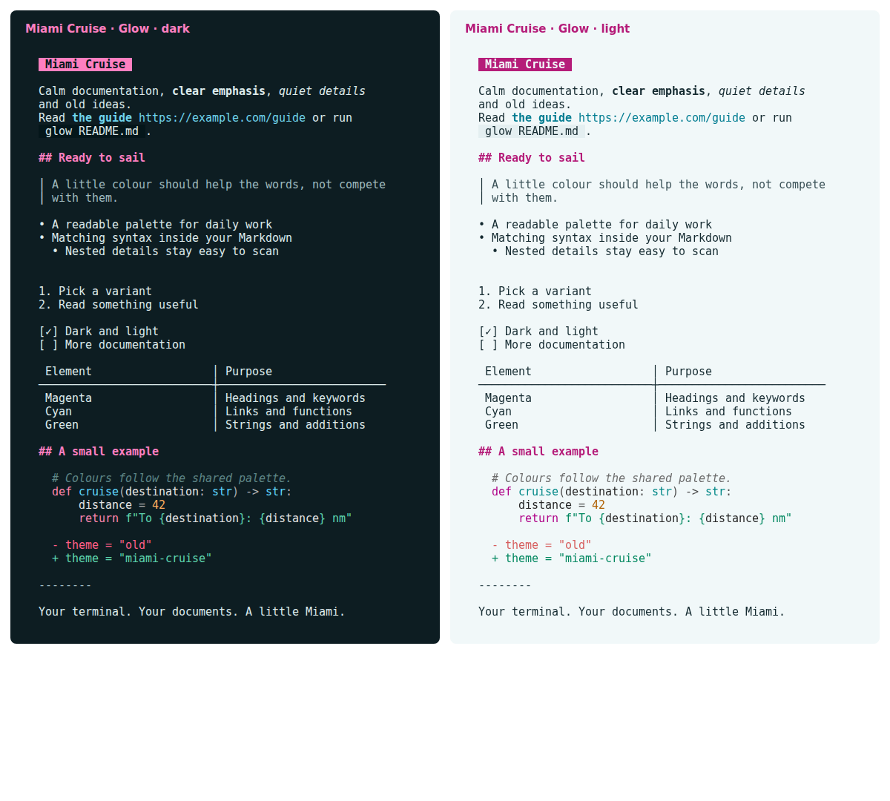

# Miami Cruise for Glow

Readable Markdown, magenta headings and matching code syntax in your terminal.



## Install

The theme files:

- [`miami-cruise-dark.json`](miami-cruise-dark.json): Glamour Markdown style · dark
- [`miami-cruise-light.json`](miami-cruise-light.json): Glamour Markdown style · light

Native Glamour JSON styles for rendered Markdown, not replacement glow.yml files. Glow itself is unmodified. Browser lists, help bars and pager chrome retain their built-in colours. These files do not change keybindings, paging, wrapping or file discovery.

Run the commands below from this folder, or from wherever you saved the file.

### 1. Try a Markdown style

Install Glow and use a true-colour terminal with a matching dark or light background. Keep these JSON files in a permanent folder. Back up same-named customized files before copying. There is no bat dependency, syntax-cache build or patched Glow binary.

**Linux / macOS**

```bash
mkdir -p ~/.config/glow/styles
cp miami-cruise-dark.json miami-cruise-light.json ~/.config/glow/styles/
glow -s "$HOME/.config/glow/styles/miami-cruise-dark.json" README.md
```

**Windows (PowerShell)**

```powershell
$styles = Join-Path $env:APPDATA "glow/styles"
New-Item -ItemType Directory -Force $styles | Out-Null
Copy-Item miami-cruise-dark.json, miami-cruise-light.json $styles
glow -s (Join-Path $styles "miami-cruise-dark.json") README.md
```

Use miami-cruise-light.json for light mode. Each file is one explicit palette; Glow's built-in auto selection does not switch between these two custom files. The Markdown body and fenced-code blocks leave the background unset, so your terminal background shows through. Inline-code chips and first-level headings retain accent fills. Choose the variant that contrasts with your terminal background.

> [!NOTE]
> Markdown body colours (headings, links, quotes, tables) render true-colour. Fenced-code syntax highlighting goes through Chroma's terminal256 formatter, so those colours are quantized to the nearest of 256 terminal colours and can look very slightly off from the exact palette hex.

### 2. Keep your current Glow settings

For persistence, edit only the style key in your existing glow.yml, preserving pager, width, mouse and other settings. Run glow --help to find your platform's config path, or glow config to open it. Use the actual absolute JSON path; the example below must be adapted to your machine.

```yaml
style: "/absolute/path/to/miami-cruise-dark.json"
```

> [!NOTE]
> This is a complete Markdown stylesheet, not a merge with another custom stylesheet. Familiar heading prefixes, list markers, quote bars and emphasis are included. Glow's -s flag overrides the style key. Keep your existing width and paging preferences; the theme does not set them.

**Linux / macOS**

```bash
# Optional one-off width, without editing config:
glow -s "$HOME/.config/glow/styles/miami-cruise-light.json" -w 80 README.md
```

### 3. Scope and removal

The same Markdown style can be used when reading documents in Glow's TUI. It does not theme the file browser, search/list selection, status/help bars or other application chrome. No upstream patch or custom Glow build is involved.

To uninstall, restore your previous style key (or remove it to use Glow's default auto style) and stop passing this JSON path via -s. Then remove only the two Miami Cruise JSON files. Other Glow settings stay intact.

> [!NOTE]
> Tested with Glow 3.0.0 on Linux. The JSON format is Glamour's native Markdown styling API; older versions and other platforms are not verified. Reference: https://github.com/charmbracelet/glow#styles

## Details

- **Variants:** dark and light
- **Covers:** Markdown body, headings, emphasis, links/images, quotes, rules, lists/tasks, tables, definitions, inline code and fenced-code syntax
- **Glow:** No: the flat palette (Glow is the application name)
- **Tested:** Glow 3.0.0 (Glamour 2.0.1) on Linux: dark/light styles, file and stdin input, config loading and CLI style precedence, headings, emphasis, quotes, lists/tasks, tables, inline code, Python/JSON/diff/plain code blocks, true-colour output and width control. Browser/pager chrome intentionally not themed; macOS/Windows not tested

## More

- [Website page for Glow](https://lanjelin.github.io/miami-cruise/apps/glow.html)
- [Palette and specification](../../docs/SPEC.md)
- [Report a problem](https://github.com/lanjelin/miami-cruise/issues/new/choose)
- [MIT licence](../../LICENSE)
