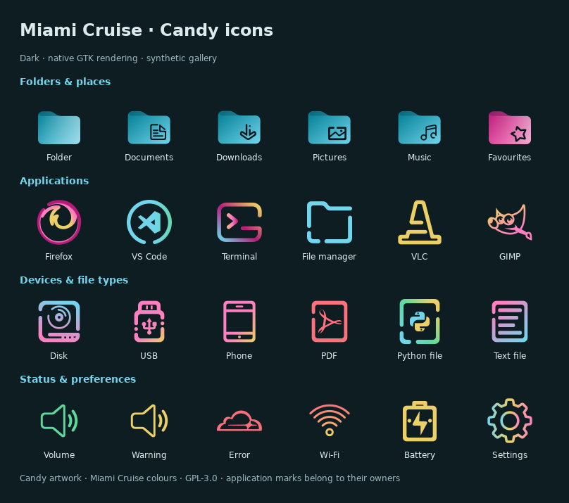
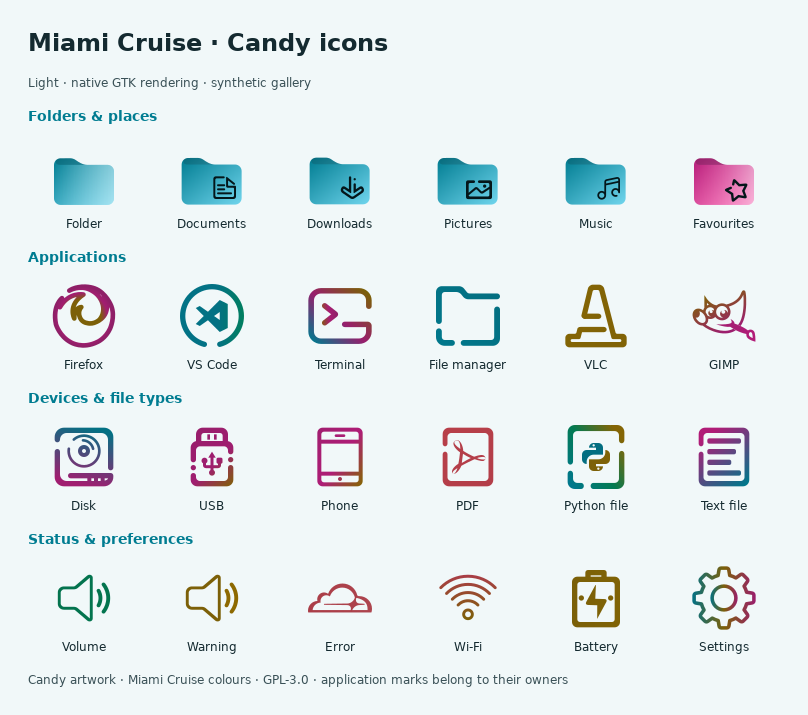

# Miami Cruise for Candy icons

Candy’s expressive shapes and gradients, recoloured with the Miami Cruise palette.




## Install

The theme files:

- [`Miami-Cruise-Candy-Dark.tar.gz`](Miami-Cruise-Candy-Dark.tar.gz): Dark icon theme
- [`Miami-Cruise-Candy-Light.tar.gz`](Miami-Cruise-Candy-Light.tar.gz): Light icon theme
- [`miami-cruise-candy-source.tar.gz`](miami-cruise-candy-source.tar.gz): Corresponding source · GPL-3.0

Choose Dark or Light to match your desktop, or download both. The source archive is optional and only needed for rebuilding the themes.

Run the commands below from this folder, or from wherever you saved the file.

### 1. Install the icon theme

Extract your chosen download into your user icon directory. Back up any existing same-named folder first, including its target if it is a symlink. No root access is needed.

```bash
icon_dir="${XDG_DATA_HOME:-$HOME/.local/share}/icons"
mkdir -p "$icon_dir"
tar -xzf Miami-Cruise-Candy-Dark.tar.gz -C "$icon_dir"
tar -xzf Miami-Cruise-Candy-Light.tar.gz -C "$icon_dir"
```

> [!NOTE]
> Run only the command for each variant you downloaded. Icon selection is separate from your desktop style; fonts, wallpaper, cursors and panel layout stay unchanged.

### 2. Update the icon cache

After installing or updating the theme, refresh its icon cache. This is recommended for GTK applications, though they can load icons without it. Run the command for each variant you installed.

```bash
gtk-update-icon-cache -f "$icon_dir/Miami-Cruise-Candy-Dark"
gtk-update-icon-cache -f "$icon_dir/Miami-Cruise-Candy-Light"
```

> [!NOTE]
> Use the same icon_dir as in the extraction step. If gtk-update-icon-cache is unavailable, your distribution’s GTK icon-cache utility provides it. You do not need sudo for themes in your user icon directory.

### 3. Select your icons

In XFCE, open Settings → Appearance → Icons. Record your previous icon theme, then select Miami-Cruise-Candy-Dark or Miami-Cruise-Candy-Light. On other Linux desktops, use the icon-theme setting in your appearance preferences.

> [!NOTE]
> If the theme is missing, reopen Appearance. After an update, refresh the cache, switch to another icon theme and back, and reopen apps that still show old icons. Some apps use their own artwork; missing icons use your system’s fallback themes.

### 4. Restore your previous icons

Select your recorded previous icon theme before removing Miami Cruise. Remove only unchanged installation-owned folders, or restore backed-up same-named folders. Preserve later edits, existing symlinks and unrelated themes. No change to GTK or window-decoration settings is required.

> [!NOTE]
> Based on Candy by EliverLara and contributors: https://github.com/EliverLara/candy-icons. Modified artwork, licence and corresponding source are supplied under GPL-3.0. Brand names and marks belong to their respective owners; inclusion does not imply endorsement.

## Details

- **Variants:** dark and light
- **Covers:** 3,860 application, device, file-type, folder, settings and status icon names. Four embedded bitmap images retain their original colours
- **Glow:** Original gradients and transparency, with palette-derived endpoints; Light strokes use a restrained ink blend for readability
- **Tested:** Both styles reviewed on an isolated Arch Linux/XFCE 4.20 desktop, including Thunar, panel/menu icons, selections and small/large sizes. Native SVG loading and reproducible packages checked; HiDPI and other desktops not yet verified

## More

- [Website page for Candy icons](https://lanjelin.github.io/miami-cruise/apps/icons.html)
- [Palette and specification](../../docs/SPEC.md)
- [Report a problem](https://github.com/lanjelin/miami-cruise/issues/new/choose)
- [Candy licence and attribution](../../vendor/candy/README.md)
