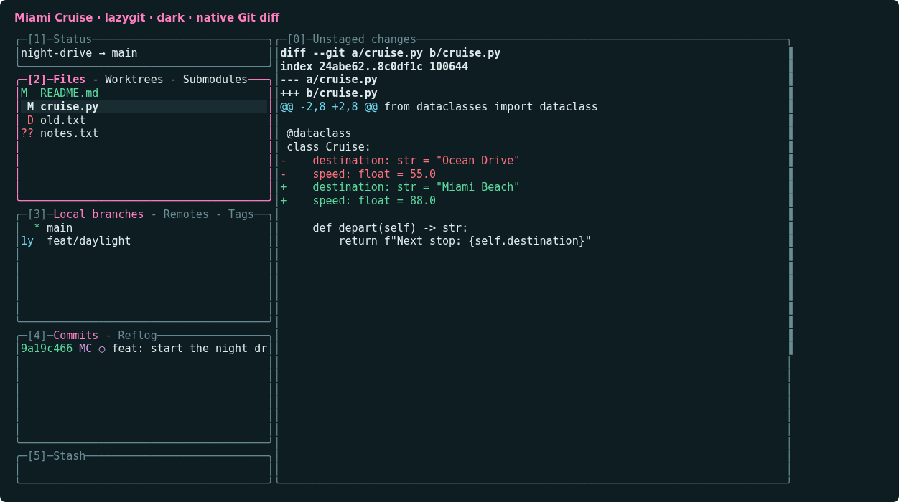
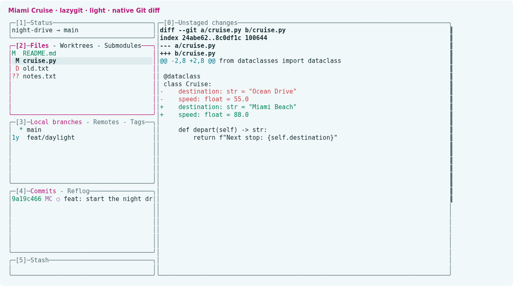
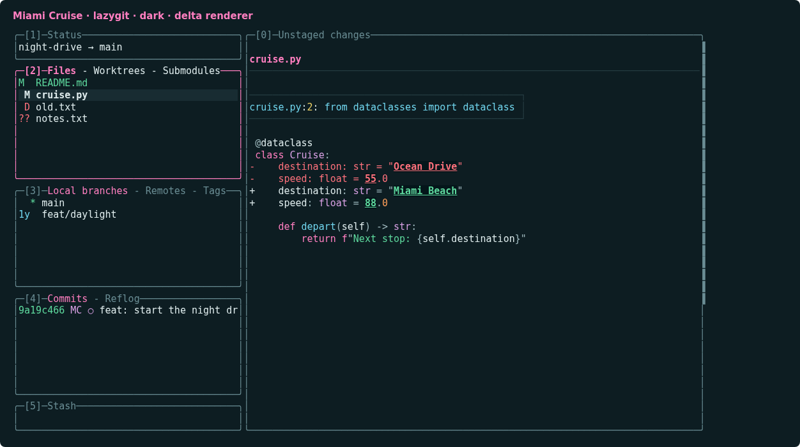
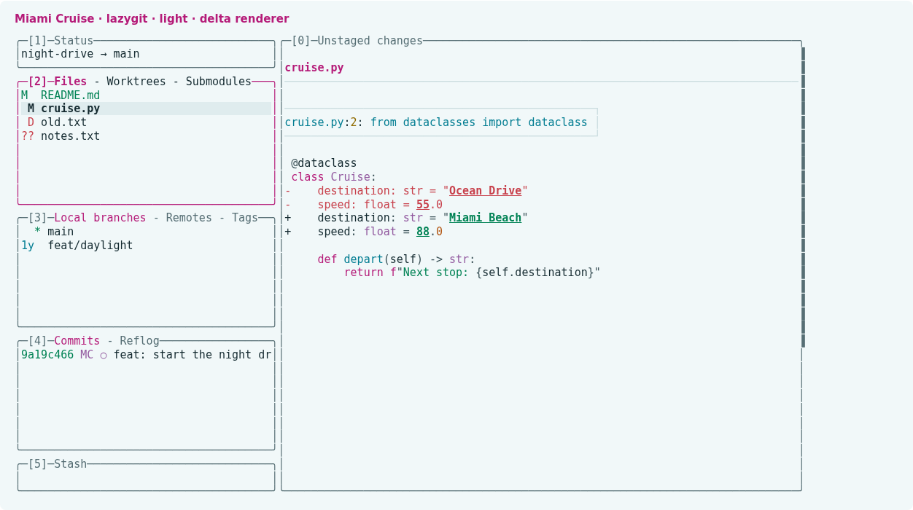

# Miami Cruise for lazygit

A calm Git interface with magenta focus, clear selections and readable status colours.






## Install

The theme files:

- [`miami-cruise.yml`](miami-cruise.yml): Automatic dark/light theme
- [`miami-cruise-dark.yml`](miami-cruise-dark.yml): Fixed dark theme
- [`miami-cruise-light.yml`](miami-cruise-light.yml): Fixed light theme

Run the commands below from this folder, or from wherever you saved the file.

### 1. Load the theme as a separate config layer

Install lazygit first. Keep the downloaded theme in a permanent folder. The commands below load it after your existing config, preserving your other settings. Run them inside a Git repository, and use the actual absolute path to the theme.

**macOS / Linux**

```bash
lg_dir="$(lazygit --print-config-dir)"
if [ -f "$lg_dir/config.yml" ]; then
  lazygit --use-config-file="$lg_dir/config.yml,/absolute/path/to/miami-cruise.yml"
else
  lazygit --use-config-file="/absolute/path/to/miami-cruise.yml"
fi
```

**Windows (PowerShell)**

```powershell
$lgDir = lazygit --print-config-dir
$baseConfig = Join-Path $lgDir "config.yml"
$theme = "C:/absolute/path/to/miami-cruise.yml"
if (Test-Path $baseConfig) {
  lazygit --use-config-file="$baseConfig,$theme"
} else {
  lazygit --use-config-file=$theme
}
```

Alternatively merge the theme's `gui` keys into your existing config (back it up first); do not replace the whole file or create duplicate `gui` keys. If you already use several config layers, append this theme to your current list. Repository-specific settings can override global settings.

> [!NOTE]
> These files change appearance only: no keybindings, network behaviour, Git commands, layouts or pager preferences are set. To uninstall, remove the theme from your config-layer list, or restore the GUI keys you merged.

### 2. Optional: load the config layers through your environment

Instead of passing `--use-config-file` each time, export `LG_CONFIG_FILE` with the same comma-separated paths. This example uses lazygit's reported config directory and the same theme-path placeholder as above. It preserves an existing layer list and adds the theme last:

**macOS / Linux**

```bash
lg_dir="$(lazygit --print-config-dir)"
lg_files="${LG_CONFIG_FILE:-}"
if [ -z "$lg_files" ] && [ -f "$lg_dir/config.yml" ]; then
  lg_files="$lg_dir/config.yml"
fi
export LG_CONFIG_FILE="${lg_files:+$lg_files,}/absolute/path/to/miami-cruise.yml"
lazygit
```

**Windows (PowerShell)**

```powershell
$lgDir = lazygit --print-config-dir
$baseConfig = Join-Path $lgDir "config.yml"
$lgFiles = $env:LG_CONFIG_FILE
if (!$lgFiles -and (Test-Path $baseConfig)) { $lgFiles = $baseConfig }
$theme = "C:/absolute/path/to/miami-cruise.yml"
$env:LG_CONFIG_FILE = if ($lgFiles) { "$lgFiles,$theme" } else { $theme }
lazygit
```

Replace the theme placeholder with its permanent absolute path. This sets the layer list for the current shell and child processes. For new sessions, put the resolved `LG_CONFIG_FILE` assignment in your shell profile, keeping your existing layers and listing the theme only once; do not repeatedly append it on each startup. Use the automatic file shown here or substitute a fixed dark/light file. To stop loading the theme, remove only its path from the list.

### 3. Choose automatic or fixed colours

`miami-cruise.yml` uses lazygit's native `gui.darkTheme`/`gui.lightTheme` support. It queries the terminal's background, not your desktop setting. If the terminal does not reply, lazygit defaults to dark. For a reliable manual choice, load `miami-cruise-dark.yml` or `miami-cruise-light.yml` instead.

> [!NOTE]
> Use a true-colour terminal with the matching Miami Cruise foreground, background and ANSI palette. lazygit does not set the terminal background; raw Git diffs and some status colours use terminal ANSI colours. The UI theme does not replace your diff renderer. Native automatic detection depends on terminal support; both automatic-file branches were tested with explicit colour-scheme overrides.

### 4. Optional: use the Miami Cruise delta diff renderer

Install the Miami Cruise delta port and its syntax cache first. Then merge this optional setting into your lazygit config. This example is for lazygit 0.66.3's `git.diffRenderers` format; older versions may use `git.pagers`.

```yaml
git:
  diffRenderers:
    - name: Miami Cruise delta
      colorArg: never
      command: delta --features=miami-cruise-{{colorScheme}} --{{colorScheme}} --paging=never --true-color=always
```

This selects the matching delta feature for lazygit's dark/light choice. delta must be on PATH, and its Miami Cruise feature definitions and compatible bat cache must already be installed. The plain lazygit theme has no dependency on bat or delta.

## Details

- **Variants:** dark and light
- **Covers:** Focused/inactive/search borders, selections, help, unstaged changes, authors, copied commits and marked-base colours; diffs remain the renderer's responsibility
- **Glow:** No: the flat palette
- **Tested:** lazygit 0.66.3 on Linux: dark/light layers, automatic-theme overrides, files, staging, branches, commits and search; optional delta 0.20.1 with bat 0.26.1; macOS and Windows not tested

## More

- [Website page for lazygit](https://lanjelin.github.io/miami-cruise/apps/lazygit.html)
- [Palette and specification](../../docs/SPEC.md)
- [Report a problem](https://github.com/lanjelin/miami-cruise/issues/new/choose)
- [MIT licence](../../LICENSE)
