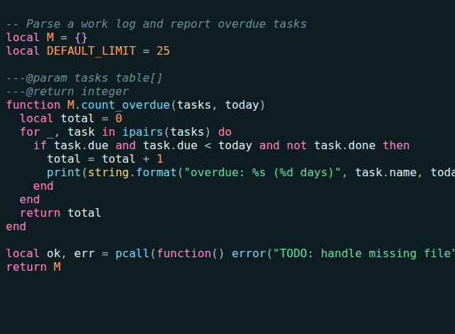
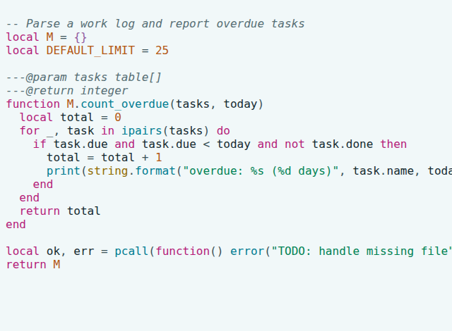

# Miami Cruise for Neovim

A Neovim colorscheme with Treesitter, LSP, diagnostics, diff, gitsigns and Telescope.




## Install

The theme files:

- [`colors/miami-cruise.lua`](colors/miami-cruise.lua): Neovim colorscheme

Run the commands below from the [`colors/`](colors) folder, or from wherever you saved the file.

### 1. Put it where Neovim looks for colorschemes

**macOS / Linux**

```bash
mkdir -p ~/.config/nvim/colors
cp miami-cruise.lua ~/.config/nvim/colors/
```

**Windows (PowerShell)**

```powershell
New-Item -ItemType Directory -Force "$env:LOCALAPPDATA\nvim\colors" | Out-Null
Copy-Item miami-cruise.lua "$env:LOCALAPPDATA\nvim\colors\"
```

> [!NOTE]
> If you set `$XDG_CONFIG_HOME`, use `$XDG_CONFIG_HOME/nvim/colors/` instead.

### 2. Turn it on

Add this to your `init.lua`. To try it first, run `:colorscheme miami-cruise` inside Neovim.

```lua
vim.o.background = "dark" -- or "light"
vim.cmd.colorscheme("miami-cruise")
```

### 3. Switch between dark and light

The theme follows `'background'`. Change it at any time and the colours update: `:set background=light`.

> [!NOTE]
> It turns on `termguicolors` for you, so a true-colour terminal is needed.

## Details

- **Variants:** dark and light
- **Covers:** Editor UI, Treesitter, LSP, diagnostics, diff, gitsigns, Telescope, :terminal colours
- **Glow:** No: a flat palette
- **Tested:** Neovim 0.12 with Treesitter

## More

- [Website page for Neovim](https://lanjelin.github.io/miami-cruise/apps/nvim.html)
- [Palette and specification](../../docs/SPEC.md)
- [Report a problem](https://github.com/lanjelin/miami-cruise/issues/new/choose)
- [MIT licence](../../LICENSE)
