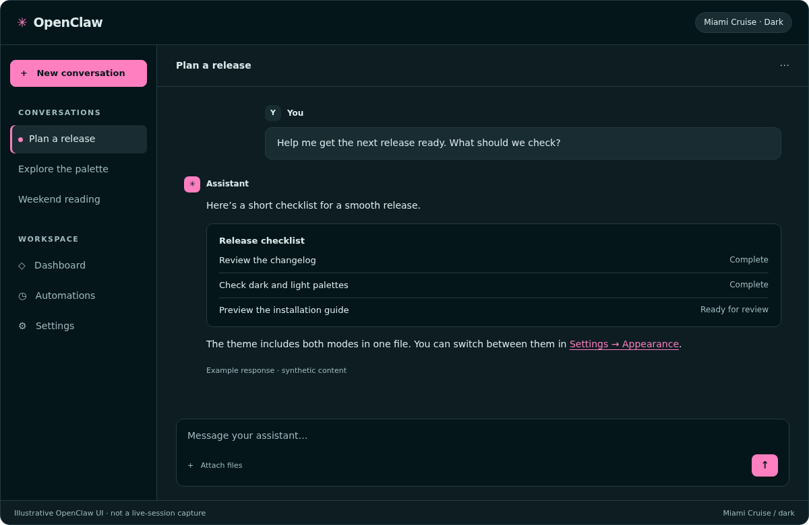
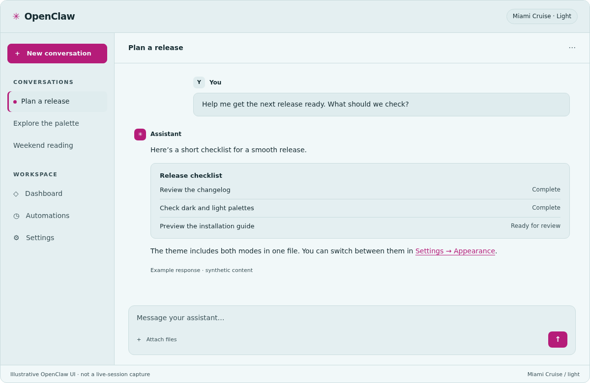

# Miami Cruise for OpenClaw

Miami Cruise for the OpenClaw Control UI, with native dark and light palettes.




## Install

The theme files:

- [`miami-cruise.json`](miami-cruise.json): Native personal theme · dark and light

Both dark and light palettes are included. Miami Cruise changes the interface colours and is separate from OpenClaw’s built-in Miami theme.

### 1. Add Miami Cruise

Paste this prompt into your OpenClaw chat. Your agent will download and add the theme for you.

```text
Download this native OpenClaw theme definition from the website and import it as a personal theme with id miami-cruise:
https://lanjelin.github.io/miami-cruise/downloads/openclaw/miami-cruise.json
Read my current theme and mode first. Preserve any existing user/miami-cruise definition before replacing it. Save the new definition with apply=false; do not change my appearance yet.
```

Your current appearance stays unchanged until you select the theme.

### 2. Select dark, light or system mode

Open Settings → Appearance and select Miami Cruise, then choose Dark, Light or System. You can also ask your agent to select the theme and your preferred mode.

> [!NOTE]
> System mode follows your device’s appearance. Any custom accent colour you have set may override the theme’s accent.

### 3. Restore your previous appearance

Choose your previous theme in Settings → Appearance, or ask your agent to restore your previous appearance.

> [!NOTE]
> More about appearance settings: https://docs.openclaw.ai/web/control-ui/settings#appearance-themes

## Details

- **Variants:** dark and light
- **Covers:** Native page, card, popover, primary/secondary controls, muted text, accent, destructive actions, borders, inputs and focus ring tokens
- **Glow:** OpenClaw derives its own hover, selection and focus effects from the native colours; no custom glow stylesheet
- **Tested:** OpenClaw 2026.11.3 native theme parser, complete dark/light semantic palettes and text contrast checks. User reported successful agent import on 2026-11-13; exact runtime version and mode coverage not recorded. Previews are offline illustrations, not native component captures or proof of live rendering

## More

- [Website page for OpenClaw](https://lanjelin.github.io/miami-cruise/apps/openclaw.html)
- [Palette and specification](../../docs/SPEC.md)
- [Report a problem](https://github.com/lanjelin/miami-cruise/issues/new/choose)
- [MIT licence](../../LICENSE)
