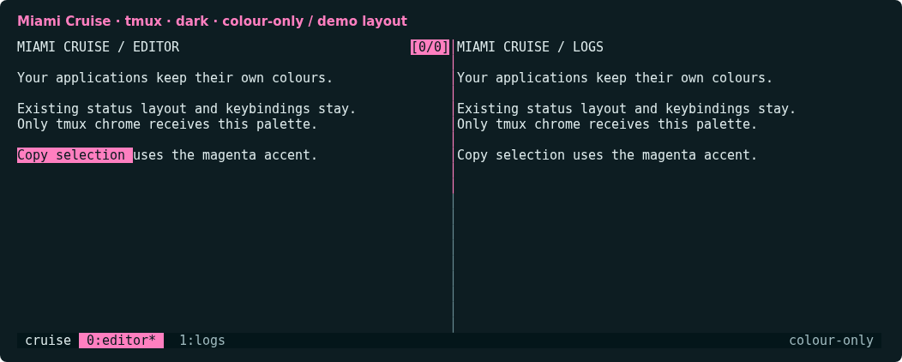
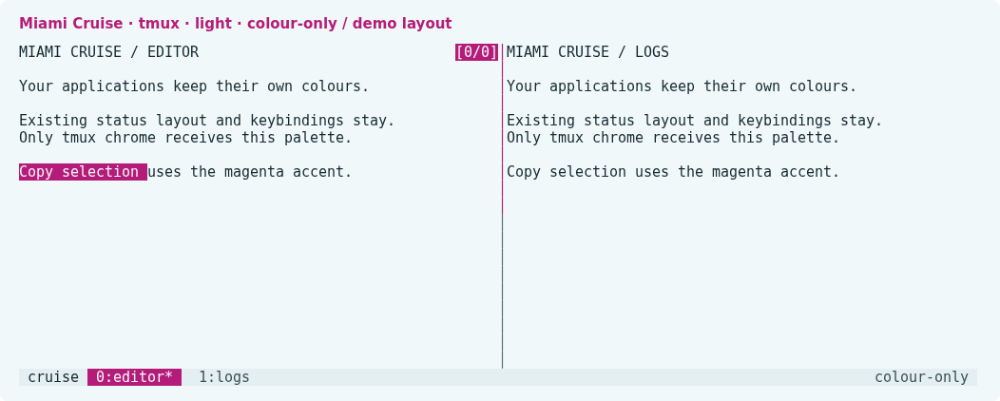

# Miami Cruise for tmux

Miami Cruise colours for your existing tmux layout.




## Install

The theme files:

- [`miami-cruise-dark.conf`](miami-cruise-dark.conf): Native tmux colours · dark
- [`miami-cruise-light.conf`](miami-cruise-light.conf): Native tmux colours · light

Colour-only tmux command files, not replacement configs or TPM plugins. No status formats, segments, separators, lengths, positioning, bindings, hooks or shell commands. Existing text attributes are merged rather than reset. Applications inside panes keep their own colours.

Run the commands below from this folder, or from wherever you saved the file.

### 1. Load colours without replacing your config

Requires tmux 3.4 or newer and a true-colour terminal. Copy the files into a permanent folder. Back up any same-named customized files first. Do not replace your existing tmux config.

**Linux / macOS**

```bash
mkdir -p ~/.config/tmux/themes
cp miami-cruise-dark.conf miami-cruise-light.conf ~/.config/tmux/themes/
# Try it in the current tmux server:
tmux source-file ~/.config/tmux/themes/miami-cruise-dark.conf
```

To persist it, add this line after your existing theme/plugin initialization and colour settings in your current tmux config. Use light instead of dark for the light variant. There is no automatic switching.

```tmux
source-file ~/.config/tmux/themes/miami-cruise-dark.conf
```

> [!NOTE]
> The file does not change terminal-features, default-terminal or terminal-overrides. Keep your existing true-colour capability configuration. Lower-colour clients may quantize the palette.

### 2. Keep your powerline bar

Your status-left, status-right, status-format, window formats, icons and powerline separators are left byte-for-byte unchanged. This is not a new status-bar design. The screenshots use a disposable demonstration layout which is not included in the downloaded theme.

> [!WARNING]
> Inline colour directives such as #[fg=...,bg=...] in an existing powerline format override these base styles. Plugin-generated colours and local session/window styles can also take precedence. The port deliberately does not rewrite those strings or remove local overrides. Not every segment of an existing theme will automatically recolour.

For those segments, use your current theme/plugin palette settings and the Miami Cruise tokens: accent for the active segment, on-accent for its text, panel for the bar background, and text/muted for labels. Change only its colour values; keep its format and separator structure. The exact mapping depends on the theme/plugin you use.

> [!NOTE]
> A plugin that reapplies its colours later can override this file. Source the file after that initialization or configure the plugin colours directly. This port does not add hooks to compete with it.

### 3. Switch or remove

**Linux / macOS**

```bash
tmux source-file ~/.config/tmux/themes/miami-cruise-light.conf
```

To uninstall, remove the source-file line and reload your original theme/config so it restores the affected colours. Deleting the file alone does not undo styles already loaded in a running server. For styles your old config never sets, fresh tmux servers will use the normal defaults; do not kill a server containing work just to reset colours.

> [!NOTE]
> Native style and option reference: https://github.com/tmux/tmux/blob/3.4/tmux.1

## Details

- **Variants:** dark and light
- **Covers:** Status bar, current/inactive/activity/bell windows, pane borders and numbers, copy-mode selection, prompts, menus, popups and clock colour
- **Glow:** No: the flat palette
- **Tested:** tmux 3.4 on Linux: both variants, repeated sourcing and switching, status/window/pane colours, copy selection, messages, menus and popups; preservation of powerline format strings, attributes, layout, bindings and unrelated options. Other tmux releases and macOS not tested

## More

- [Website page for tmux](https://lanjelin.github.io/miami-cruise/apps/tmux.html)
- [Palette and specification](../../docs/SPEC.md)
- [Report a problem](https://github.com/lanjelin/miami-cruise/issues/new/choose)
- [MIT licence](../../LICENSE)
