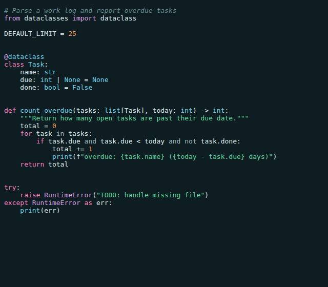
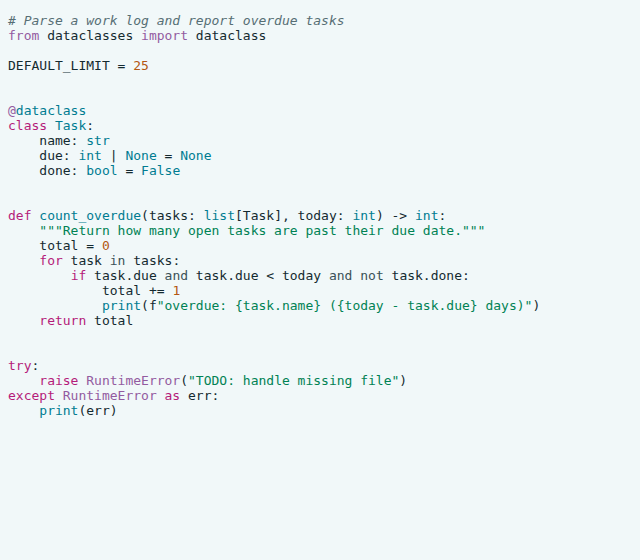

# Miami Cruise for Vim

A Vim colorscheme with true colour and a 256-colour fallback.




## Install

The theme files:

- [`colors/miami-cruise.vim`](colors/miami-cruise.vim): Vim colorscheme

Run the commands below from the [`colors/`](colors) folder, or from wherever you saved the file.

### 1. Put it where Vim looks for colorschemes

**macOS / Linux**

```bash
mkdir -p ~/.vim/colors
cp miami-cruise.vim ~/.vim/colors/
```

**Windows (PowerShell)**

```powershell
New-Item -ItemType Directory -Force "$HOME\vimfiles\colors" | Out-Null
Copy-Item miami-cruise.vim "$HOME\vimfiles\colors\"
```

### 2. Turn it on

Add this to your `vimrc`. To try it first, run `:colorscheme miami-cruise`.

```vim
syntax on
set termguicolors       " if your terminal supports true colour
set background=dark   " or light
colorscheme miami-cruise
```

### 3. Colours in the terminal

Use `set termguicolors` for the exact Miami Cruise background and colours in a true-colour terminal. The theme also enables it automatically when `$COLORTERM` is `truecolor` or `24bit`, but some true-colour terminals do not set that variable. Without true colour, Vim uses approximate xterm-256 colours; the dark background becomes neutral grey instead of teal-black.

> [!NOTE]
> Changing `background` later reloads the theme by itself.

## Details

- **Variants:** dark and light
- **Covers:** Editor UI, syntax groups, diff, spell, popup menu, tab line, terminal colours
- **Glow:** No: a flat palette
- **Tested:** Vim 9.1

## More

- [Website page for Vim](https://lanjelin.github.io/miami-cruise/apps/vim.html)
- [Palette and specification](../../docs/SPEC.md)
- [Report a problem](https://github.com/lanjelin/miami-cruise/issues/new/choose)
- [MIT licence](../../LICENSE)
