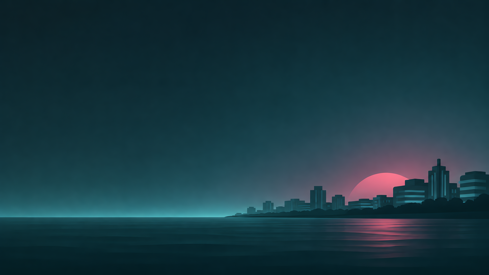
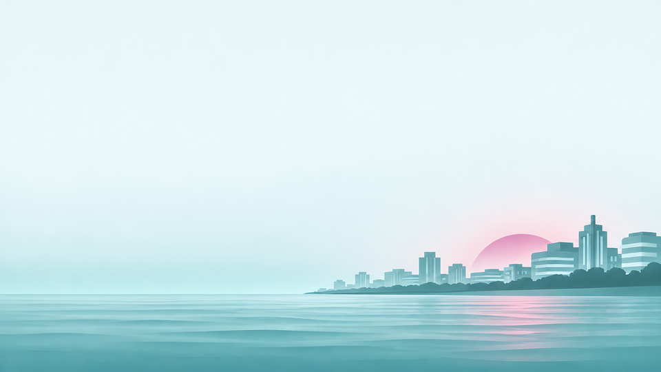

# Miami Cruise for Wallpapers

A quiet coast, a magenta sun and room to breathe. Miami Coast in dark and light.

## Install

The theme files:

- [`miami-coast-dark-4k.png`](miami-coast-dark-4k.png): Dark wallpaper · 3840 × 2160 PNG
- [`miami-coast-light-4k.png`](miami-coast-light-4k.png): Light wallpaper · 3840 × 2160 PNG
- [`LICENSE.txt`](LICENSE.txt): MIT licence

Choose either wallpaper or keep both. These are optional companions to the desktop theme and icons; nothing is applied automatically. AI-generated artwork, enhanced with super-resolution and exported at 3840 × 2160.

### 1. Save your wallpaper

Save the Dark or Light PNG somewhere you want to keep it, such as your Pictures/Wallpapers folder. Keep the file there while it is selected as your background.

> [!NOTE]
> Each download is a 3840 × 2160 image. Other aspect ratios may crop the scene depending on your desktop’s scaling setting.

### 2. Set your background

In XFCE, right-click the desktop and open Desktop Settings → Background. Note your current image and scaling setting, then choose the folder containing Miami Coast and select the image. Zoomed fills the screen; Scaled keeps the whole image visible.

> [!NOTE]
> Choose the intended display and workspace before applying. Leave any options to apply across all workspaces or displays unchanged unless that is what you want. Other desktops provide similar controls in their background settings.

### 3. Restore your previous background

Open the same background settings and select your previous image and scaling setting. Restore only the displays and workspaces you changed. Switch away from Miami Coast before removing its PNG.

> [!NOTE]
> The wallpapers are offered under the collection’s MIT licence. They are AI-generated and super-resolution upscaled, not native-resolution photographs or pixel-exact palette exports.

## Details

- **Variants:** dark and light
- **Covers:** A matching dark/light coastal skyline with quiet space on the left for desktop icons. Designed for 16:9 displays
- **Glow:** Soft cyan horizon and restrained magenta sunset; baked into the image
- **Tested:** Both final PNGs visually reviewed, dimensions and file integrity checked. Super-resolution tile-boundary checks passed; originals and desktop settings preserved

## More

- [Website page for Wallpapers](https://lanjelin.github.io/miami-cruise/apps/wallpapers.html)
- [Palette and specification](../../docs/SPEC.md)
- [Report a problem](https://github.com/lanjelin/miami-cruise/issues/new/choose)
- [MIT licence](../../LICENSE)
