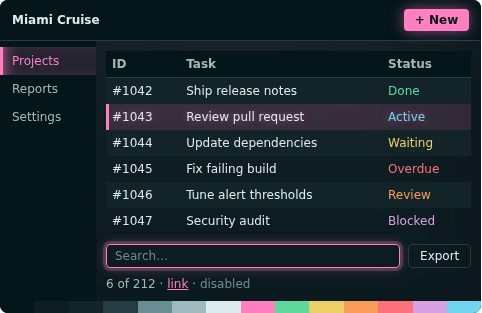
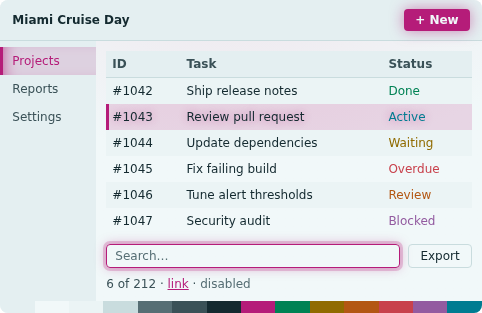
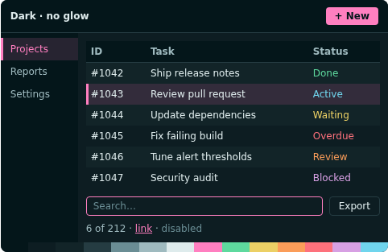

# Miami Cruise for Web / CSS

CSS variables for the palette, plus an optional glow layer.





## Install

The theme files:

- [`miami-cruise.css`](miami-cruise.css): CSS variables
- [`glow.css`](glow.css): Optional glow layer

Run the commands below from this folder, or from wherever you saved the file.

### 1. Link the stylesheets

```html
<link rel="stylesheet" href="miami-cruise.css">
<!-- optional -->
<link rel="stylesheet" href="glow.css">
```

### 2. Use the variables

```css
body { background: var(--mc-bg); color: var(--mc-text); }
a { color: var(--mc-accent); }
.card { background: var(--mc-panel); border: 1px solid var(--mc-border); }
.btn { background: var(--mc-accent); color: var(--mc-on-accent); }
```

With `glow.css` you can add `mc-primary` (glowing button), `mc-focus` (glowing focus ring), `mc-selected` and `mc-surface` (soft top-lit background).

> [!NOTE]
> The glow only decorates states that already work without it, and browsers without `color-mix` simply skip it.

### 3. Dark, light, or follow the system

Dark is the default. Set `data-theme="light"` on `<html>` for the light variant. To follow the system:

```html
<script>
  var m = matchMedia("(prefers-color-scheme: light)");
  function sync() { document.documentElement.dataset.theme = m.matches ? "light" : "dark"; }
  m.addEventListener("change", sync); sync();
</script>
```

## Details

- **Variants:** dark and light
- **Covers:** All 17 palette tokens as --mc-* variables, dark and light, and four optional glow classes
- **Glow:** Optional: glow.css
- **Tested:** The project's own website is built on exactly these files

## More

- [Website page for Web / CSS](https://lanjelin.github.io/miami-cruise/apps/web.html)
- [Palette and specification](../../docs/SPEC.md)
- [Report a problem](https://github.com/lanjelin/miami-cruise/issues/new/choose)
- [MIT licence](../../LICENSE)
