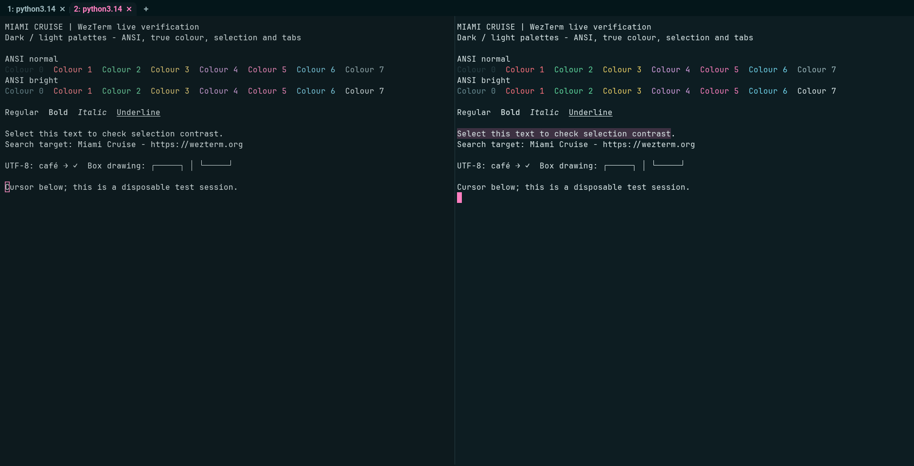
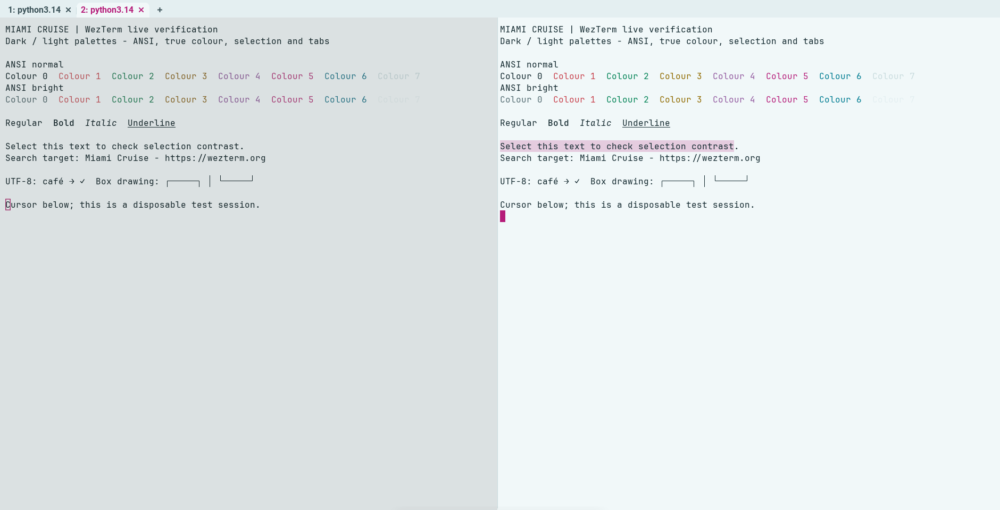

# Miami Cruise for WezTerm

Colour schemes and tab bar that follow your system's dark or light setting.




## Install

The theme files:

- [`miami-cruise.lua`](miami-cruise.lua): WezTerm module

Run the commands below from this folder, or from wherever you saved the file.

### 1. Put it next to your wezterm.lua

**macOS / Linux**

```bash
mkdir -p ~/.config/wezterm
cp miami-cruise.lua ~/.config/wezterm/
```

**Windows (PowerShell)**

```powershell
New-Item -ItemType Directory -Force "$HOME\.config\wezterm" | Out-Null
Copy-Item miami-cruise.lua "$HOME\.config\wezterm\"
```

> [!NOTE]
> It must sit in the same folder as your config file. If you use a single `~/.wezterm.lua`, put it in your home folder.

### 2. Load it in your config

> [!NOTE]
> Already have a config? Keep it and add the `package.path` and `apply(config)` lines near the end, before `return config`. Back it up first. Remove conflicting old `config.colors` overrides (for example selection colours), which otherwise override the selected scheme. The module merges window-frame colours without changing fonts, bindings, layout or tab-bar style; it replaces the tab-bar colour table.

```lua
local wezterm = require("wezterm")
local config = wezterm.config_builder()

package.path = wezterm.config_dir .. "/?.lua;" .. package.path
require("miami-cruise").apply(config)

return config
```

That is all. The theme follows the system dark/light setting, and WezTerm reloads your config when the system switches.

> [!NOTE]
> Linux automatic appearance requires desktop support through `org.freedesktop.portal.Settings`. If WezTerm cannot read the desktop appearance, use a fixed `mode` below. A successful fixed dark/light reload does not verify system switching.

### 3. Force dark or light (optional)

Set `MIAMI_CRUISE` to `dark`, `light` or `auto` (the default) in the environment WezTerm starts from:

**macOS / Linux**

```bash
MIAMI_CRUISE=light wezterm
```

**Windows (PowerShell)**

```powershell
$env:MIAMI_CRUISE = "light"; wezterm
```

Or pin it in the config file. The environment variable still wins over this:

```lua
require("miami-cruise").apply(config, { mode = "light" })
```

> [!WARNING]
> **Launched from the Dock or Start menu?** Those don't see variables you set in a shell, so pin it in the config with `mode`.

> [!NOTE]
> The schemes are registered as `Miami Cruise` and `Miami Cruise Day`. Select the variant through `apply(config, { mode = "light" })` so terminal, tab-bar and window-frame colours stay in sync.

## Details

- **Variants:** dark and light
- **Covers:** Foreground, background, cursor, selection, 16 ANSI colours, fancy/retro tab bars, window-frame colours, copy mode, quick select
- **Glow:** No: a flat palette
- **Tested:** WezTerm 20240203-110809-5046fc22 on Arch Linux/X11: dark/light reloads, resolved palettes, fancy and retro tabs, splits, selection, search, copy mode and quick select. macOS/Windows and real system appearance transitions not tested; this XFCE session lacks the appearance portal

## More

- [Website page for WezTerm](https://lanjelin.github.io/miami-cruise/apps/wezterm.html)
- [Palette and specification](../../docs/SPEC.md)
- [Report a problem](https://github.com/lanjelin/miami-cruise/issues/new/choose)
- [MIT licence](../../LICENSE)
