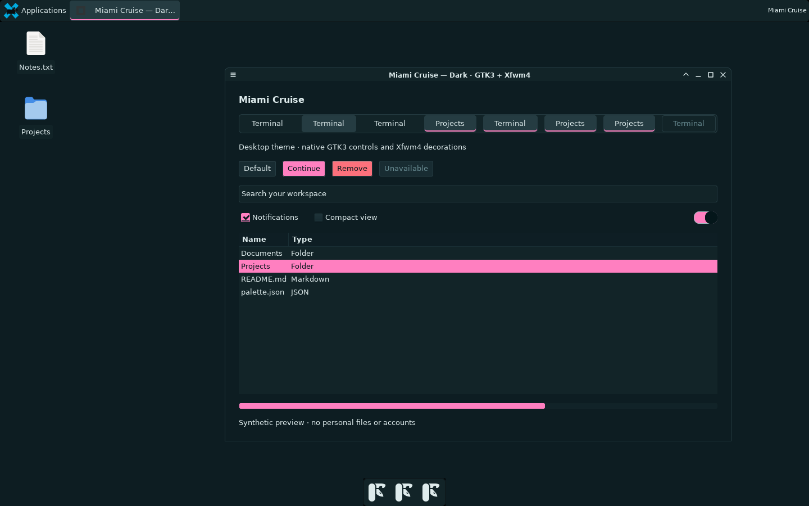
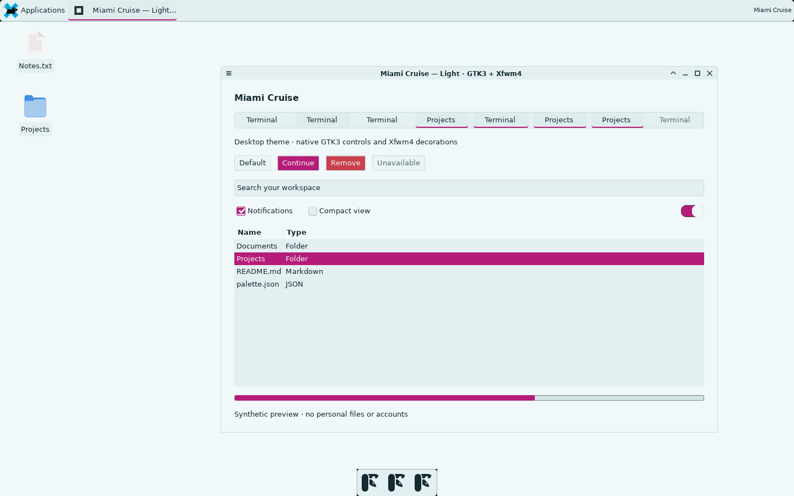
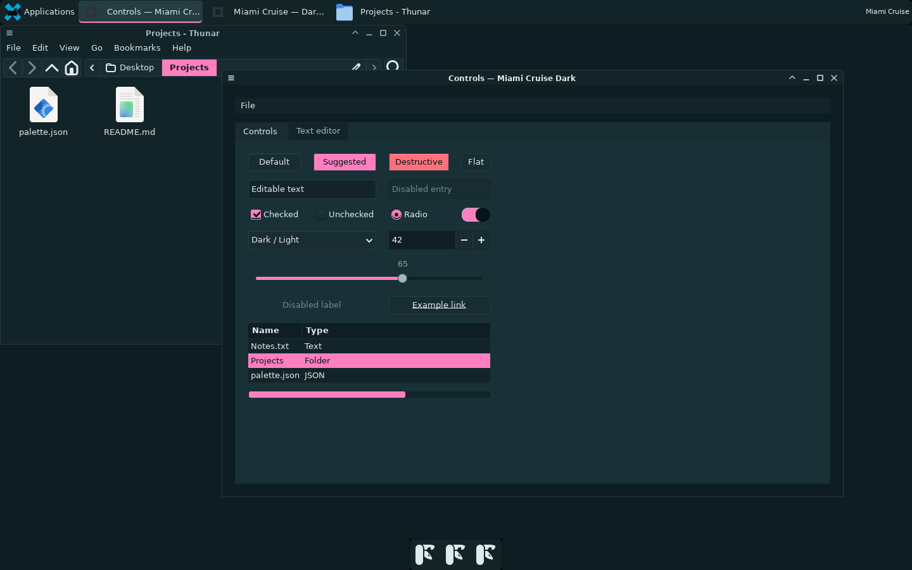
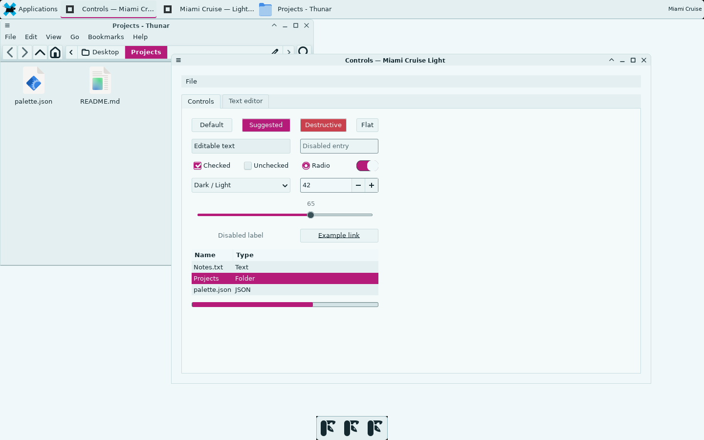

# Miami Cruise for XFCE

Teal-ink widgets, magenta selection and matching window decorations for your existing XFCE desktop.






## Install

The theme files:

- [`Miami-Cruise-Dark.tar.gz`](Miami-Cruise-Dark.tar.gz): GTK3 + Xfwm4 · dark
- [`Miami-Cruise-Light.tar.gz`](Miami-Cruise-Light.tar.gz): GTK3 + Xfwm4 · light
- [`miami-cruise-xfce-source.tar.gz`](miami-cruise-xfce-source.tar.gz): Corresponding source · GPL-2.0-or-later

Each variant archive is a complete fixed-variant theme based on Greybird. The source archive is optional for rebuilding; do not extract it into your theme directory. No separate base theme installation required. Desktop theme files are GPL-2.0-or-later, not the collection’s MIT licence; attribution and licence texts are included.

Run the commands below from this folder, or from wherever you saved the file.

### 1. Install the theme folders

Download either variant or both. Before extracting, preserve any existing same-named theme folders. Install locally; no root access is needed.

```bash
theme_dir="${XDG_DATA_HOME:-$HOME/.local/share}/themes"
mkdir -p "$theme_dir"
tar -xzf Miami-Cruise-Dark.tar.gz -C "$theme_dir"
tar -xzf Miami-Cruise-Light.tar.gz -C "$theme_dir"
```

> [!NOTE]
> If you downloaded only one variant, run only its extraction command. This theme targets GTK3 on XFCE; existing icons, cursors, fonts, wallpaper and panel layout stay unchanged.

### 2. Select the theme

First note your current choices in Settings → Appearance → Style and Settings → Window Manager → Style. Choose Miami-Cruise-Dark or Miami-Cruise-Light in both places. These are two independent settings; no automatic dark/light switching is configured.

> [!NOTE]
> If the theme is not listed immediately, reopen the settings window. When updating an installed theme, select a different style in Appearance, then select Miami Cruise again. Copying updated files alone does not refresh running XFCE apps. Reopen any application that still retains the old styling; if needed, log out and back in. Reselect a different Window Manager style and back when updating decorations. GTK4/libadwaita, Qt and independently styled apps may not follow it. Do not copy theme CSS into global GTK configuration.

### 3. Restore your previous appearance

Select your recorded previous styles in both settings windows. After switching away, remove only the Miami Cruise theme folders you installed, or restore backed-up same-named folders. Leave icons, cursors, fonts and all other settings alone.

> [!NOTE]
> Based on Greybird: https://github.com/shimmerproject/Greybird · XFCE appearance: https://docs.xfce.org/xfce/xfce4-settings/appearance

## Details

- **Variants:** dark and light
- **Covers:** GTK3 controls, menus, Thunar, GTK-styled panel surfaces and Xfwm4 window decorations. Custom panel backgrounds may override theme colours
- **Glow:** No; restrained focus outlines and the base theme’s shadows
- **Tested:** GTK 3.24.52, Xfwm4 4.20.0, xfdesktop 4.20.2, xfce4-panel 4.20.8 and Thunar 4.20.10 in private Xvnc sessions: both variants and native desktop/panel/menu/widget states inspected; 162 measured control contrast checks passed. User desktop testing confirmed readability; HiDPI testing remains pending. No GTK2, GTK4/libadwaita or Qt coverage promised

## More

- [Website page for XFCE](https://lanjelin.github.io/miami-cruise/apps/xfce.html)
- [Palette and specification](../../docs/SPEC.md)
- [Report a problem](https://github.com/lanjelin/miami-cruise/issues/new/choose)
- [Desktop theme licence and base attribution](../../vendor/greybird/README.md)
