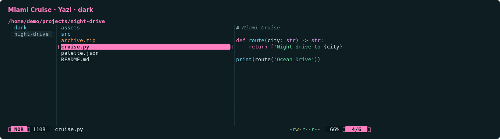
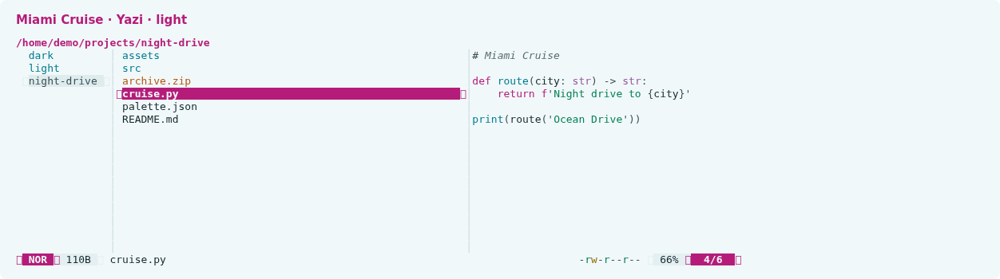

# Miami Cruise for Yazi

A calm file manager with magenta focus and matching code previews.




## Install

The theme files:

- [`miami-cruise-dark.yazi.zip`](miami-cruise-dark.yazi.zip): Yazi flavor · dark
- [`miami-cruise-light.yazi.zip`](miami-cruise-light.yazi.zip): Yazi flavor · light

Each ZIP contains a native Yazi flavor and its matching code-preview syntax palette. No plugins, keymaps, file openers or layout settings are changed. Icons retain Yazi's default glyphs and colours.

Run the commands below from this folder, or from wherever you saved the file.

### 1. Install the two flavors

Install Yazi first. Extract both ZIPs into your Yazi `flavors` directory. Each archive contains one `miami-cruise-*.yazi` folder with `flavor.toml` and `tmtheme.xml` inside. The shell example uses `unzip`; any ZIP extractor works. Keep any existing Yazi configuration and back up same-named custom flavors before replacing them.

**Linux / macOS**

```bash
yazi_dir="${YAZI_CONFIG_HOME:-${XDG_CONFIG_HOME:-$HOME/.config}/yazi}"
mkdir -p "$yazi_dir/flavors"
unzip miami-cruise-dark.yazi.zip -d "$yazi_dir/flavors"
unzip miami-cruise-light.yazi.zip -d "$yazi_dir/flavors"
```

**Windows (PowerShell)**

```powershell
$yaziDir = if ($env:YAZI_CONFIG_HOME) { $env:YAZI_CONFIG_HOME } else { Join-Path $env:APPDATA "yazi/config" }
New-Item -ItemType Directory -Force "$yaziDir/flavors" | Out-Null
Expand-Archive miami-cruise-dark.yazi.zip "$yaziDir/flavors"
Expand-Archive miami-cruise-light.yazi.zip "$yaziDir/flavors"
```

### 2. Select dark and light in your existing theme.toml

Add or update these two entries in the existing `[flavor]` section of `theme.toml` in your Yazi config directory. If there is no file or section yet, create one. Preserve all other sections and avoid a duplicate `[flavor]` header.

```toml
[flavor]
dark = "miami-cruise-dark"
light = "miami-cruise-light"
```

Start Yazi in a true-colour terminal with a matching dark or light background. Yazi chooses the flavor from the terminal's colour scheme on startup; this is not tied to your desktop setting. If your terminal cannot report its scheme, select just one variant for both entries.

> [!NOTE]
> The flavor styles Yazi's UI and text/code previews. Image previews, external previewers and applications launched from Yazi keep their own colours. It does not set the terminal background.

### 3. Switch or remove

To switch manually, set both `dark` and `light` to the desired flavor name, then restart Yazi. To remove it, restore your previous `[flavor]` entries (or remove only these two) and delete the two Miami Cruise flavor folders. Other Yazi settings stay untouched.

> [!NOTE]
> Native flavor format and configuration: https://yazi-rs.github.io/docs/flavors/overview/

## Details

- **Variants:** dark and light
- **Covers:** File kinds, pane indicators, borders, tabs, modes, status and permissions, dialogs, notifications, help and syntax-highlighted previews
- **Glow:** No: the flat palette
- **Tested:** Yazi 26.9.1 on Linux: both flavor packages recognized by Yazi; matching styles rendered in isolated sessions with file list, selection, tabs, status bar, help and code preview. Terminal appearance auto-detection and macOS/Windows not tested

## More

- [Website page for Yazi](https://lanjelin.github.io/miami-cruise/apps/yazi.html)
- [Palette and specification](../../docs/SPEC.md)
- [Report a problem](https://github.com/lanjelin/miami-cruise/issues/new/choose)
- [MIT licence](../../LICENSE)
