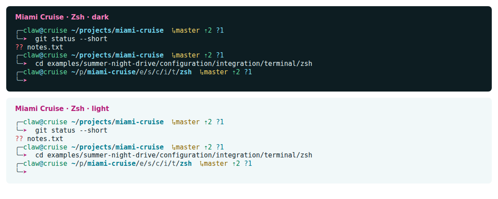

# Miami Cruise for Zsh

A configurable prompt with adaptive paths and Git status.



## Install

The theme files:

- [`miami-cruise-dark.zsh-theme`](miami-cruise-dark.zsh-theme): Oh My Zsh prompt · dark
- [`miami-cruise-light.zsh-theme`](miami-cruise-light.zsh-theme): Oh My Zsh prompt · light

Two-line by default, with optional single-line layout and transient scrollback. Includes user@host, adaptive path, Ruby/virtualenv, Git status and right-side exit status. Each theme file includes the required MIT licence notice. Installing it does not change your plugins, aliases or other shell settings.

Run the commands below from this folder, or from wherever you saved the file.

### 1. Install alongside your existing Oh My Zsh setup

Install Oh My Zsh first. Copy both files into its custom themes folder. Keep your existing `plugins=(...)`, aliases and other settings. Back up any same-named custom themes before copying.

**Linux / macOS**

```bash
mkdir -p "${ZSH_CUSTOM:-${ZSH:-$HOME/.oh-my-zsh}/custom}/themes"
cp miami-cruise-dark.zsh-theme miami-cruise-light.zsh-theme "${ZSH_CUSTOM:-${ZSH:-$HOME/.oh-my-zsh}/custom}/themes/"
```

Set `ZSH_THEME` to `miami-cruise-dark` or `miami-cruise-light` in your current `~/.zshrc`, before the line that sources `oh-my-zsh.sh`. Replace the existing theme assignment; do not add a second one. Start a new shell to see it.

```zsh
ZSH_THEME="miami-cruise-dark"
```

> [!NOTE]
> Leave your existing plugin list and `source "$ZSH/oh-my-zsh.sh"` line intact. The downloaded theme does not alter completion, suggestions or syntax highlighting.

### 2. Choose layout and scrollback

Both flags are independent and opt-in. Set them before sourcing Oh My Zsh, alongside `ZSH_THEME`, then start a new shell. Omit a flag or set it to `0` to keep the original behaviour.

```zsh
MIAMI_CRUISE_SINGLE_LINE=1
MIAMI_CRUISE_TRANSIENT_PROMPT=1
ZSH_THEME="miami-cruise-dark"
```

`MIAMI_CRUISE_SINGLE_LINE=1` puts the context and command on one line instead of two. `MIAMI_CRUISE_TRANSIENT_PROMPT=1` reduces a submitted nonempty prompt to its coloured arrow, leaving the command and output in scrollback without user, host, path or Git context. The next editable prompt shows full context again. This changes display only, not command history. It works with either layout and needs no Powerlevel10k plugin. Terminal scrollback preservation can retain an old prompt when a redraw clears the screen; in tmux, its `scroll-on-clear` option controls this (the theme does not change it).

### 3. Read the path and Git segments

Paths stay complete until they exceed 80 characters or the available space in a narrow terminal. Then intermediate folders use their shortest unique sibling prefixes. The final folder and project roots (for example a folder containing `.git`, `package.json` or `go.mod`) stay complete. The abbreviated path is display-only; `$PWD` is unchanged.

For example, `master ⇡2 ?1` means the branch is master, two commits ahead of its upstream and one untracked file. `⇣` is commits behind, `+` staged files, `!` unstaged files and `×` conflicts. Zero counts are hidden; there is no Git segment outside a repository.

> [!NOTE]
> Ahead/behind compares against your local upstream-tracking ref. Run `git fetch` to refresh it; the prompt does not contact the network. The theme checks Git status on each prompt, which may be noticeable in very large repositories.

### 4. Switch or remove

To switch, change only `ZSH_THEME` to the other variant and start a new shell. There is no automatic dark/light switching. To remove, restore your previous `ZSH_THEME` value and start a new shell; then delete the copied files if desired.

> [!NOTE]
> This colours the prompt only. Command syntax highlighting is controlled by its plugin, and terminal text/background by your terminal theme. Original theme and customization reference: https://github.com/ohmyzsh/ohmyzsh/wiki/Customization#overriding-and-adding-themes

## Details

- **Variants:** dark and light
- **Covers:** One- or two-line prompt, optional transient scrollback, user and host, adaptive path, Git branch and status counts, Ruby and virtualenv markers, exit status, root and SSH cues
- **Glow:** No: the flat palette
- **Tested:** Zsh 5.9 and Oh My Zsh on Linux: dark/light load, prompt layout, all layout/transient flag combinations (including wrapped/multiline commands and Ctrl-C), adaptive path and marker anchors, Git branch/ahead/behind/staged/unstaged/untracked counts, venv/Ruby slots, exit status and SSH/root colour branches; macOS not tested

## More

- [Website page for Zsh](https://lanjelin.github.io/miami-cruise/apps/zsh.html)
- [Palette and specification](../../docs/SPEC.md)
- [Report a problem](https://github.com/lanjelin/miami-cruise/issues/new/choose)
- [MIT licence](../../LICENSE)
