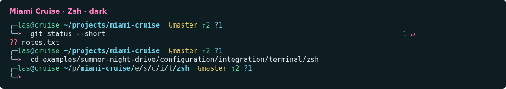
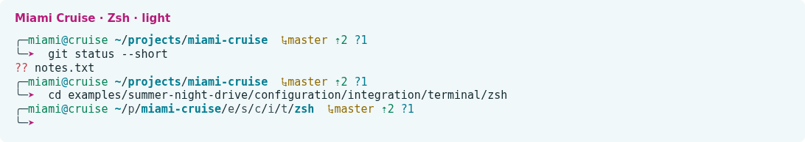

# Miami Cruise for Zsh

A configurable prompt with adaptive paths, async Git and compact context.




## Install

The theme files:

- [`miami-cruise-dark.zsh-theme`](miami-cruise-dark.zsh-theme): Oh My Zsh prompt · dark
- [`miami-cruise-light.zsh-theme`](miami-cruise-light.zsh-theme): Oh My Zsh prompt · light

Both colour variants support direct sourcing or Oh My Zsh. Installing the theme does not change your plugins, aliases or other shell settings. Use a Nerd Font for the complete icon set, or set `MIAMI_CRUISE_ASCII=1` before loading the theme for plain ASCII symbols without a special font.

Run the commands below from this folder, or from wherever you saved the file.

### 1. Install alongside your existing Oh My Zsh setup

Install Oh My Zsh first. Copy both files into its custom themes folder. Keep your existing `plugins=(...)`, aliases and other settings. Back up any same-named custom themes before copying.

**Linux / macOS**

```bash
mkdir -p "${ZSH_CUSTOM:-${ZSH:-$HOME/.oh-my-zsh}/custom}/themes"
cp miami-cruise-dark.zsh-theme miami-cruise-light.zsh-theme "${ZSH_CUSTOM:-${ZSH:-$HOME/.oh-my-zsh}/custom}/themes/"
```

Set `ZSH_THEME` to `miami-cruise-dark` or `miami-cruise-light` in your current `~/.zshrc`, before the line that sources `oh-my-zsh.sh`. Replace the existing theme assignment; do not add a second one. Start a new shell to see it.

```zsh
ZSH_THEME="miami-cruise-dark"
```

> [!NOTE]
> Leave your existing plugin list and `source "$ZSH/oh-my-zsh.sh"` line intact. The downloaded theme does not alter completion, suggestions or syntax highlighting.

### 2. Choose layout and scrollback

Layout and transient mode are independent and opt-in. Set them before sourcing Oh My Zsh, alongside `ZSH_THEME`, then start a new shell. Omit a flag or set it to `0` to keep the original behaviour.

```zsh
MIAMI_CRUISE_SINGLE_LINE=1
MIAMI_CRUISE_TRANSIENT_PROMPT=1 # 0 = off, 1 = always, same-dir = repeated directories
ZSH_THEME="miami-cruise-dark"
```

`MIAMI_CRUISE_SINGLE_LINE=1` puts the context and command on one line instead of two. `MIAMI_CRUISE_TRANSIENT_PROMPT=1` reduces a submitted nonempty prompt to its coloured arrow, leaving the command and output in scrollback without user, host, path or Git context.

Use `MIAMI_CRUISE_TRANSIENT_PROMPT=same-dir` to keep the first submitted prompt after entering a directory complete, then compact subsequent prompts in that same directory. Returning to a directory after running a command elsewhere retains a full prompt again. Blank input and cancelled editing do not advance this directory tracking. The next editable prompt always shows full context again.

When timestamps are enabled, compact prompts retain only the arrow on the left and submission time on the far right. This changes display only, not command history. It works with either layout and needs no Powerlevel10k plugin.

Terminal scrollback preservation can retain an old prompt when a redraw clears the screen; in tmux, its `scroll-on-clear` option controls this (the theme does not change it).

### 3. Choose context segments

The block below shows the defaults, grouped by purpose. Boolean flags accept `1` (on) or `0` (off): set an off-by-default flag to `1` to opt in, or an on-by-default flag to `0` to opt out. Omitted settings use their defaults. Configure them before loading the theme, whether sourcing it directly or through Oh My Zsh; these options work with either layout and every transient mode. Right-hand segments appear left to right in this order: Python/Conda environment, shell/Yazi level, ASCII vi-mode label, jobs, command duration, failure details, timestamp. Disabled or empty segments are omitted; the timestamp is always rightmost. Identity, directory, Ruby and Git context appear on the left. In Unicode mode, vi mode changes the prompt arrow instead of adding a right-hand label. Vi-mode display does not change your key bindings.

```zsh
# Identity and directory
MIAMI_CRUISE_SMART_CONTEXT=0        # off by default: user@host only for SSH/root
MIAMI_CRUISE_SHOW_READ_ONLY=1       # on by default: lock before non-writable path
MIAMI_CRUISE_SHOW_SHELL_LEVEL=0     # off by default: nested shell/Yazi level
MIAMI_CRUISE_SHOW_VIRTUALENV=1      # on by default: Python virtualenv/Conda name

# Git
MIAMI_CRUISE_SHOW_GIT=1             # on by default: Git status segment
MIAMI_CRUISE_ASYNC_GIT=1            # on by default: background status; 0 = synchronous
MIAMI_CRUISE_SHOW_GIT_OPERATION=0   # off by default: merge/rebase/cherry-pick/bisect/am

# Command results
MIAMI_CRUISE_SHOW_RETURN_CODE=1     # on by default: nonzero exit status
MIAMI_CRUISE_SHOW_PIPELINE_STATUS=0 # off by default: per-stage codes for failed pipelines
MIAMI_CRUISE_SIGNAL_NAMES=0         # off by default: signal names instead of numbers

# Timing and jobs
MIAMI_CRUISE_SHOW_DURATION=1        # on by default: long-command duration
MIAMI_CRUISE_DURATION_THRESHOLD=3   # default: 3 seconds; nonnegative decimals allowed
MIAMI_CRUISE_SHOW_JOBS=1            # on by default: running/suspended job counts
MIAMI_CRUISE_SHOW_TIMESTAMP=0       # off by default: local HH:MM:SS, always far right

# Input mode and symbols
MIAMI_CRUISE_SHOW_VI_MODE=0         # off by default: vi-mode indicator; bindings unchanged
MIAMI_CRUISE_ASCII=0                # off by default: plain ASCII theme symbols
```

`MIAMI_CRUISE_SHOW_RETURN_CODE=1` (the default) shows the return-code indicator for failed commands (for example `1 ↵`). Set it to `0` to hide it. Successful commands remain unmarked. This affects display only, not command exit status.

`MIAMI_CRUISE_SHOW_TIMESTAMP=1` adds a muted local `HH:MM:SS` timestamp as the absolute rightmost segment, after status and every other indicator. It shows prompt creation time while editing, refreshes to submission time when you submit, and remains visible in transient scrollback. It is not a continuously ticking clock. Like other right-prompt segments, it can be hidden by Zsh when command input overlaps it.

Elapsed time uses a Nerd Font stopwatch (for example `󱎫 3.4s`, or `3.4s` in ASCII mode) and appears after a foreground command meets the threshold and resets for the next command; editing time is excluded. Invalid thresholds fall back to 3 seconds. `⚙2` means two running jobs; `Ⅱ1` means one suspended job. Job counts refresh on the next prompt.

With `MIAMI_CRUISE_SHOW_VI_MODE=1`, the prompt arrow indicates insert (`➤`), normal (`❮`), visual (`V`) or replace (`▶`) mode, without an extra right-side label. In ASCII mode, the arrow stays `>` and right-side labels `[INS]`, `[NOR]`, `[VIS]` and `[REP]` indicate the mode instead. Emacs editing is treated as insert. Disabling the flag restores the ordinary arrow and removes labels. Colours, key bindings and existing widgets are unchanged. Existing widgets/hooks are preserved using Zsh dispatchers, without duplicate registrations when re-sourcing.

Python environments appear leftmost on the right-hand side, with a Nerd Font Python icon before the parenthesized name (for example ` (myenv)`); ASCII mode keeps `(myenv)`. A Python venv is shown only when its existing `bin` directory is on `PATH`, so stale inherited metadata alone does not create a badge. For an active Python venv, the name comes from `VIRTUAL_ENV_PROMPT` when nonempty, otherwise the final directory name from `VIRTUAL_ENV`. Without an active venv, it falls back to `CONDA_DEFAULT_ENV`. No Oh My Zsh helpers are required. Child shells can inherit a usable environment without the shell-local `deactivate` function; the theme displays that environment but does not activate or deactivate it.

If your activation script also prepends an environment name, configure that tool to disable its own prompt modification (for standard venv, set `VIRTUAL_ENV_DISABLE_PROMPT=1` before activation).

Ruby remains optional and uses `ruby_prompt_info` only when available. The generated files also work when sourced directly in Zsh 5.9, without Oh My Zsh.

`MIAMI_CRUISE_SHOW_PIPELINE_STATUS=1` shows a failed pipeline as `[1|0] ↵`, including an earlier failure when the final command succeeds; all-success pipelines stay unmarked. `MIAMI_CRUISE_SIGNAL_NAMES=1` translates conventional signal statuses into names such as `SIGINT` or `SIGTERM`. An explicit `exit 130` cannot be distinguished from SIGINT. `MIAMI_CRUISE_SHOW_RETURN_CODE=0` hides both kinds of failure detail. These are display options: the theme never changes `pipefail` or command exit status.

`MIAMI_CRUISE_SHOW_GIT_OPERATION=1` adds interrupted operations to the Git segment: `merge`, `rebase 2/5` (when progress is available), `cherry-pick`, `revert`, `bisect` or `am`. Checks run in the existing async worker and support linked worktrees; disabling async makes these checks synchronous too. No Git metadata is changed.

`MIAMI_CRUISE_SMART_CONTEXT=1` hides user@host locally but keeps it for SSH sessions and root.

`MIAMI_CRUISE_SHOW_READ_ONLY=1` (the default) adds a lock icon `` immediately before the path when the current directory fails an effective-user writability check (a Nerd Font is needed for the lock glyph; ASCII mode uses `[RO]` in the same position); set `MIAMI_CRUISE_SHOW_READ_ONLY=0` to hide it. This is not a prediction that every file operation will succeed.

`MIAMI_CRUISE_SHOW_SHELL_LEVEL=1` adds ` sh:2` for `SHLVL` above 1, or ` yazi:1` when a positive `YAZI_LEVEL` is present. These icons require a Nerd Font; ASCII mode keeps `sh:2` and `yazi:1` without icons. Shell depth follows inherited environment values and can include terminal launch wrappers.

`MIAMI_CRUISE_ASCII=1` selects `>`, `+-`, `git:`, `^`/`v`, `x`, `exit`, `jobs:` and `stopped:` instead of font-dependent theme glyphs. It applies to both layouts and transient prompts, without rewriting branch names, paths or other user text. Set this flag before sourcing; re-source or restart to switch symbol sets. Pipeline details, signal names, Git operation labels, smart context, shell depth and ASCII mode default to `0`; the read-only marker defaults to `1`. No new external dependencies are needed: Zsh handles shell context and the existing Git executable handles repository information.

### 4. Read the path and Git segments

Paths stay complete until they exceed 80 characters or the available space in a narrow terminal. Then intermediate folders use their shortest unique sibling prefixes. The final folder and project roots (for example a folder containing `.git`, `package.json` or `go.mod`) stay complete. The abbreviated path is display-only; `$PWD` is unchanged.

For example, `master ⇡2 ?1` means the branch is master, two commits ahead of its upstream and one untracked file. `⇣` is commits behind, `+` staged files, `!` unstaged files and `×` conflicts. Zero counts are hidden; there is no Git segment outside a repository.

> [!NOTE]
> Ahead/behind compares against your local upstream-tracking ref. Run `git fetch` to refresh it; the prompt does not contact the network. Git status refreshes in a background worker and redraws without changing typed text. The first prompt may briefly have no Git segment; later refreshes retain the last result only in the same directory. Changing directories clears it immediately and ignores old results. Workers use no temporary files and perform no fetches. Set `MIAMI_CRUISE_ASYNC_GIT=0` for the blocking fallback, or `MIAMI_CRUISE_SHOW_GIT=0` to disable Git entirely. Detached heads show a short commit ID. Operation labels are available with `MIAMI_CRUISE_SHOW_GIT_OPERATION=1`; stash counts and tag labels are not included yet.

### 5. Switch or remove

To switch, change only `ZSH_THEME` to the other variant and start a new shell. There is no automatic dark/light switching. To remove, restore your previous `ZSH_THEME` value and start a new shell; then delete the copied files if desired.

> [!NOTE]
> This colours the prompt only. Command syntax highlighting is controlled by its plugin, and terminal text/background by your terminal theme. Original theme and customization reference: https://github.com/ohmyzsh/ohmyzsh/wiki/Customization#overriding-and-adding-themes

## Details

- **Variants:** dark and light
- **Covers:** One- or two-line prompt, optional transient scrollback, user and host, adaptive path, Git branch and status counts, Ruby and native Python/Conda markers, command duration, running/suspended jobs, optional vi-mode labels, exit status, root and SSH cues
- **Glow:** No: the flat palette
- **Tested:** Zsh 5.9 and Oh My Zsh on Linux: dark/light load, prompt layout, all layout/transient flag combinations (including wrapped/multiline commands and Ctrl-C), adaptive path and marker anchors, Git branch/ahead/behind/staged/unstaged/untracked counts, native Python/Conda environments, duration threshold/reset, running/suspended jobs, vi insert/normal/visual/replace, preserved hooks and repeat sourcing, async Git typing responsiveness and directory freshness, synchronous fallback, venv/Ruby slots, exit status, pipeline/signal details, real Git merge/rebase/cherry-pick/revert/bisect/am states and linked worktrees, context/permission/nesting flags, ASCII layouts/transient prompts, same-directory tracking including cancelled/blank editing, timestamp ordering/submission refresh, lock placement and SSH/root colour branches; macOS not tested

## More

- [Website page for Zsh](https://lanjelin.github.io/miami-cruise/apps/zsh.html)
- [Palette and specification](../../docs/SPEC.md)
- [Report a problem](https://github.com/lanjelin/miami-cruise/issues/new/choose)
- [MIT licence](../../LICENSE)
